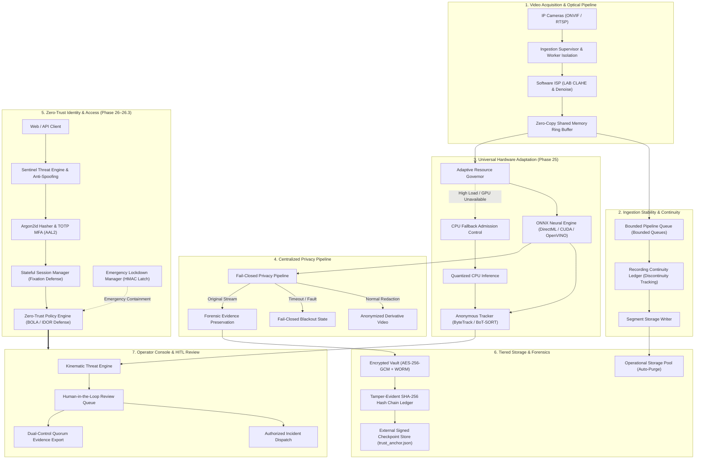
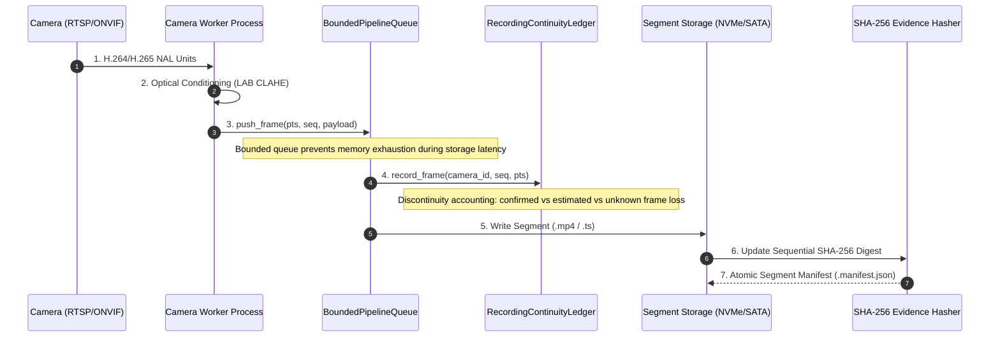
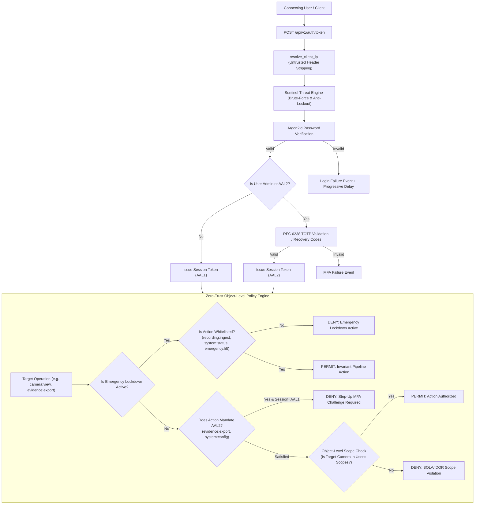
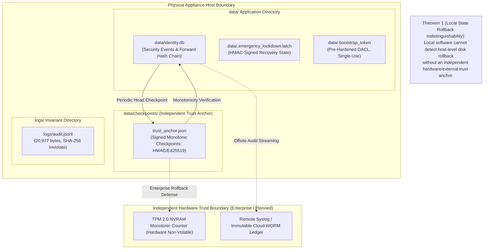
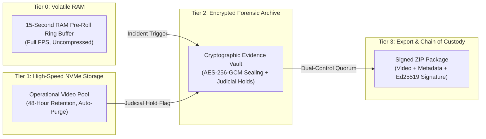
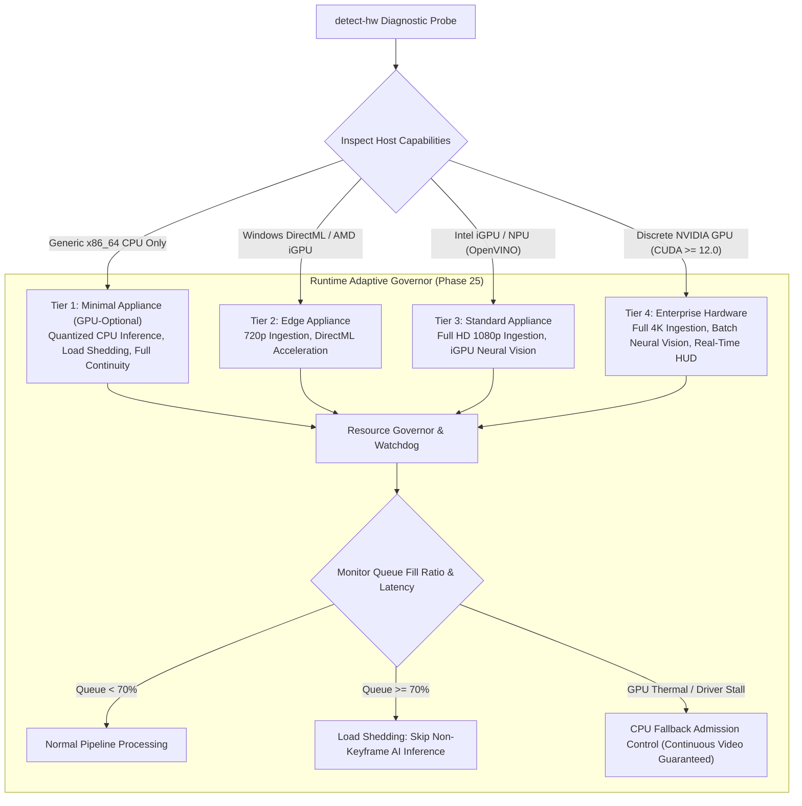

# CAMserv — Phase 26.4: Technical Architecture Diagrams & Visual Documentation

**Project:** CAMserv — Advanced Security Intelligence Platform  
**Target Release:** 0.10.0-rc7  
**Subsystem:** Technical Architecture & System Engineering Diagrams  
**Document:** `docs/PHASE-26.4-ARCHITECTURE-DIAGRAMS.md`  
**Classification:** System Architecture Specification & Visual Models  

---

## 1. Executive Summary

This document presents the official, updated technical architecture diagrams for CAMserv 0.10.0-rc7. All diagrams are authored in clean, editable **Mermaid syntax** and reflect the actual verified state of the codebase following the completion of Phase 25 (Hardware Adaptation & Appliance Engineering) and Phases 26–26.3 (Local-First Zero-Trust Identity Foundation & Trust Boundary Closure).

---

## 2. Diagram 1: High-Level Platform Architecture

---

## 3. Diagram 2: Video Ingestion & Recording Continuity Flow

---

## 4. Diagram 3: Identity, Authentication & Zero-Trust Authorization

---

## 5. Diagram 4: Security Trust Boundaries & Audit Checkpoint Anchoring

---

## 6. Diagram 5: Multi-Tier Storage Architecture & Forensic Vault

---

## 7. Diagram 6: Universal Hardware Adaptation & CPU Failover

