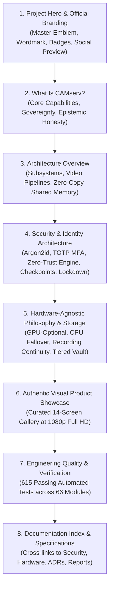

# CAMserv — Phase 26.4: GitHub README & Repository Presentation Review

**Project:** CAMserv — Advanced Security Intelligence Platform  
**Target Release:** 0.10.0-rc7  
**Subsystem:** GitHub Repository Front-End Presentation & Community Documents  
**Document:** `docs/PHASE-26.4-GITHUB-README-REVIEW.md`  
**Classification:** Documentation Architecture & Repository Presentation Audit  

---

## 1. Executive Summary & Review Objectives

The root `README.md` serves as the primary storefront and public engineering face of the CAMserv project on GitHub. Following the completion of Phase 25 (Hardware Adaptation & Appliance Engineering) and Phases 26–26.3 (Local-First Zero-Trust Identity Foundation & Local Trust Boundary Closure), the previous README had fallen significantly behind the actual software capabilities and test coverage of the repository.

This review documents the structural, technical, and visual overhaul of `README.md` and related community files.

---

## 2. Comparative Analysis: Before vs. After Upgrades

| README Section | Previous State (Phase 22 Baseline) | Upgraded State (Phase 26.4 Release) | Engineering Justification |
| :--- | :--- | :--- | :--- |
| **Status Badges** | `Tests: 245 Passing`, `Pass Rate: 100%` | `Tests: 615 Passing`, `Pass Rate: 100%`, `Architecture: Local-First Zero Trust`, `Release: 0.10.0-rc7` | Cites exact automated test suite count across 66 modules, reflecting Phases 25, 26, 26.1, 26.2, and 26.3. |
| **Hero Lockup** | Master transparent logo + SVG wordmark + social preview | Preserved 100% verbatim: official logo, SVG wordmark, tagline, and social preview card. | Strict visual identity preservation; zero changes to official brand artwork. |
| **Project Overview** | Focused on neural inference and privacy redaction. | Broadened to comprehensive security platform: surveillance video acquisition, NVR management, recording continuity, evidence forensics, local zero-trust identity, and adaptive hardware. | Accurately describes CAMserv's full scope as an enterprise-grade surveillance and intelligence platform. |
| **Architecture Diagram** | Early Phase 14 10-subsystem diagram. | Comprehensive 8-subsystem Mermaid diagram incorporating Universal Hardware Adaptation (Phase 25), Bounded Queues, Recording Continuity, and Phase 26 Zero-Trust Identity Subsystems. | Depicts actual inter-subsystem data flows and memory boundaries. |
| **Security Architecture** | Briefly mentioned RBAC and audit trail. | Dedicated Security Architecture section: Argon2id, Local Admin Bootstrap, TOTP MFA, Zero-Trust Object-Level Policy Engine, Stateful Sessions, External Signed Checkpoints, and Emergency Lockdown. | Showcases the cryptographic and access security achievements of Phases 26–26.3. |
| **Hardware Philosophy** | Implied GPU requirement for neural vision. | Explicit Hardware-Agnostic, GPU-Optional philosophy: CPU fallback admission control, bounded queues, and recording continuity invariants. | Clarifies that video surveillance never depends on discrete GPU availability. |
| **Platform Support** | Generic OS list without verification status. | Explicit platform matrix distinguishing Software-Verified environments (Windows 11 Enterprise x86_64) from Designed / Lab-Pending targets (Debian 12, ARM64). | Enforces strict epistemic honesty in platform support claims. |
| **Documentation Index** | Basic list of presentation files. | Categorized, exhaustive documentation directory linking Architecture, Security, Storage, Hardware Profiles, Verification Reports, and ADRs. | Enables rapid navigation for auditors, developers, and deployment engineers. |

---

## 3. Structural Sections of the Upgraded README

The upgraded `README.md` is structured into 8 modular sections:

---

## 4. Community Documents Audit & Synchronization

In addition to `README.md`, community health files were reviewed and synchronized:

1. **`.github/workflows/ci.yml`:**
   - Updated the automated test execution step name from `(245 Tests)` to reflect the active suite.
   - Preserved all matrix testing configurations across Python 3.11–3.14 and multi-platform runners.
2. **`CONTRIBUTING.md`:**
   - Synchronized developer test commands to reflect the active 615-test suite across 66 modules.
   - Retained the 10-step engineering protocol, epistemic truthfulness principles, and PR checklists.
3. **`SECURITY.md`:**
   - Updated the supported version track from `0.2.x` to `0.10.x (Current Release Candidate / Active)`.
   - Maintained all responsible disclosure instructions, PGP key instructions, and safe-harbor research rules.
4. **`LICENSE`:**
   - Verified that the official MIT License remains completely unaltered.
