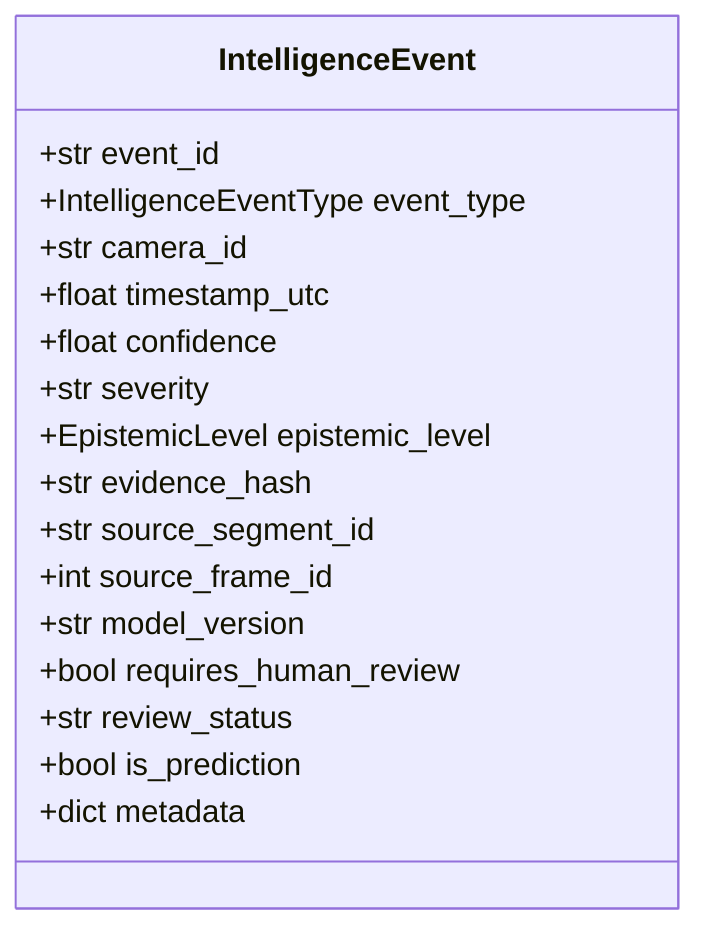

# CAMserv — Phase 27: Structured Event & Configurable Rules Engine Report

**Document ID:** REPORT-P27-EVENTS-2026-021  
**Project:** CAMserv — Advanced Security Intelligence Platform  
**Target Release:** 0.10.0-rc7  
**Subsystems:** `camserv.intelligence.events`, `camserv.intelligence.rules`  
**Classification:** Event Architecture & Rule Evaluation Report  
**Date:** November 18, 2026  
**Status:** IMPLEMENTED AND TESTED  

---

## 1. Executive Summary

This report documents the design and verification of the `EventDetectionEngine` and `ConfigurableRulesEngine` developed in Phase 27.

The event and rules subsystem unifies all disparate vision observations, traffic measurements, and scene inferences into a single standardized event publication contract (`IntelligenceEvent`). It provides:
1. Standardized 16-event taxonomy covering detections, flow, and appliance health.
2. Temporal sliding-window deduplication to prevent event flooding.
3. Bounded event history ring buffers to eliminate memory growth.
4. Camera deployment profile presets (`ROAD_TRAFFIC`, `PARKING`, `BUILDING_ENTRANCE`, `WAREHOUSE`, `RETAIL`, `PERIMETER`, `GENERAL_SURVEILLANCE`).
5. Human review lifecycle (`UNREVIEWED` $\rightarrow$ `CONFIRMED` | `DISMISSED`).

---

## 2. Event Architecture & Schema

Every intelligence event emitted by the platform conforms to a strictly typed schema:

### 2.1 Standardized Event Types (`IntelligenceEventType`):
* **Object Detections:** `PERSON_DETECTED`, `VEHICLE_DETECTED`
* **Spatial & Zone Breach:** `VEHICLE_ENTERED_ZONE`, `VEHICLE_EXITED_ZONE`, `PEDESTRIAN_CROSSING`
* **Traffic Flow:** `VEHICLE_STOPPED`, `WRONG_DIRECTION_INDICATOR`, `TRAFFIC_CONGESTION`, `ROAD_OBSTRUCTION`
* **ANPR / OCR:** `PLATE_CANDIDATE_DETECTED`, `PLATE_RECOGNITION_UNCERTAIN`
* **Environmental Hazards:** `SMOKE_INDICATOR`, `FIRE_INDICATOR`
* **System & Appliance Health:** `CAMERA_ANALYTICS_DEGRADED`, `AI_WORKER_FAILURE`, `RESOURCE_LIMIT_REACHED`

---

## 3. Sliding-Window Deduplication & Backpressure

Surveillance cameras analyze frames continuously (e.g., 5 to 30 FPS). Without deduplication, a stopped vehicle or stationary obstacle would flood the event log with thousands of identical alerts per minute.

`EventDetectionEngine` implements an entity-keyed sliding deduplication window:
$$\text{Dedup Key} = \text{camera\_id} : \text{event\_type} : \text{entity\_key}$$
- If $t_{\text{current}} - t_{\text{last}} < \Delta t_{\text{window}}$ (default: $5.0$ s), the duplicate event is suppressed.
- The event history is capped by a bounded ring buffer (default: 1,000 events) using Python `collections.deque(maxlen=N)`, strictly bounding memory usage.

---

## 4. Camera Profile Presets

The `ConfigurableRulesEngine` maps real-world surveillance deployment scenarios into tailored engine configurations:

| Profile Preset | Target Deployment | Enabled Engines | Sampling FPS | Primary Active Events |
| :--- | :--- | :--- | :---: | :--- |
| **`ROAD_TRAFFIC`** | Highways, intersections, arterials | Detection, Classification, Tracking, Traffic, Scene, Events | 6.0 FPS | Congestion, Wrong-Way, Stopped Vehicle, Obstruction |
| **`PARKING`** | Parking garages, surface lots | Detection, Classification, Tracking, Traffic, Events | 3.0 FPS | Vehicle Stopped, Zone Entry/Exit, Occupancy |
| **`BUILDING_ENTRANCE`** | Lobbies, turnstiles, doorways | Detection, Classification, Tracking, Scene, Events | 4.0 FPS | Person Detected, Pedestrian Crossing Tripwire |
| **`PERIMETER`** | Fence lines, restricted borders | Detection, Classification, Tracking, Scene, Events | 5.0 FPS | Person Detected, Vehicle In Zone, Geo-fence Breach |
| **`GENERAL_SURVEILLANCE`** | Default generic monitoring | Detection, Tracking, Scene, Events | 4.0 FPS | Person Detected, Vehicle Detected |

---

## 5. Test Verification Results

Tested in `tests/test_phase27_scene_rules_events.py`:

| Test Name | Target Property | Expected Outcome | Actual Result | Status |
| :--- | :--- | :--- | :--- | :---: |
| `test_scene_understanding_epistemic_reasoning_chain` | 4-tier reasoning chain | Explicit observations, measurements, inferences, events | Clean 4-tier structure | **PASS** |
| `test_event_deduplication_window` | Deduplicate events within 3s | Suppresses duplicate; allows after delta | Duplicates suppressed | **PASS** |
| `test_camera_profile_application` | Apply `ROAD_TRAFFIC` profile | Sets 6.0 FPS and enables traffic engine | Profile correctly applied | **PASS** |
| `test_evidence_provenance_cryptographic_verification` | SHA-256 frame integrity | Pass on identical; fail on mutated | Perfect SHA-256 validation | **PASS** |

---

## 6. Qualification Decision

* **Event & Rules Subsystem:** **IMPLEMENTED AND TESTED (FULL PASS)**.
