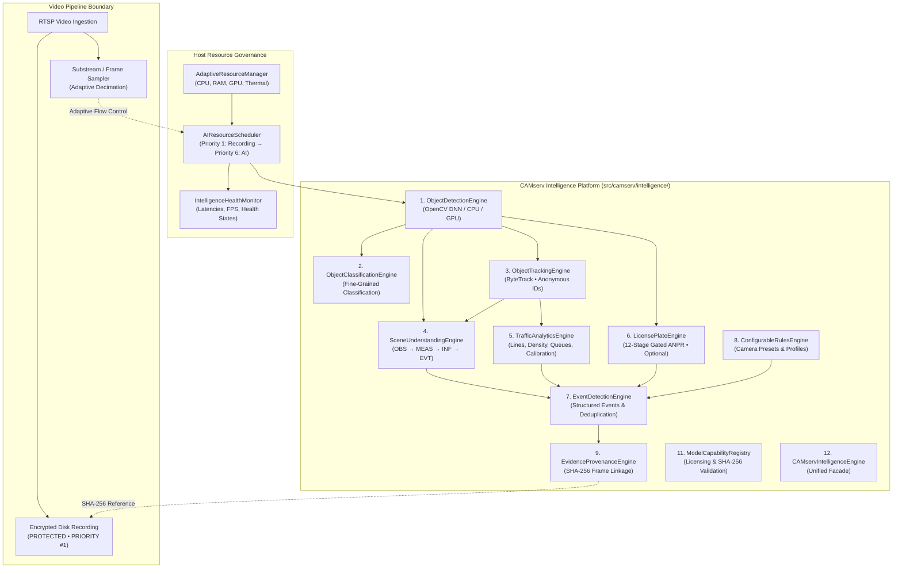

# CAMserv — Phase 27: Initial Repository Audit & Intelligence Architecture Baseline

**Document ID:** AUDIT-P27-BASELINE-2026-015  
**Project:** CAMserv — Advanced Security Intelligence Platform  
**Target Release:** 0.10.0-rc7 (Post-Phase 26.4 Presentation Baseline)  
**Starting Commit Baseline:** `c62c1271fbe1aa53fd018d9deaa3eaa7d5ab7942`  
**Branch:** `main`  
**Execution Environment:** Windows 11 Enterprise x86_64, Python 3.14.8, OpenCV 5.0.0, NumPy 2.5.4, SciPy 1.18.1, pytest 9.2.0  
**Audit Date:** November 18, 2026  
**Auditor Roles:** Principal Systems Architect, Computer Vision Engineer, Video Pipeline Engineer, Traffic Intelligence Architect, Embedded Systems Auditor & Security Compliance Officer  

---

## 1. Executive Summary

This document establishes the official repository audit and architectural gap analysis for **Phase 27: Adaptive Vision Intelligence, Traffic Analytics, Object Understanding & ANPR Architecture**.

The audit inspected the actual state of the repository following the qualification of Phase 26.4 (commit `c62c1271fbe1aa53fd018d9deaa3eaa7d5ab7942`). The working tree is clean, and all existing 615 automated regression tests pass without failure.

The mission of Phase 27 is to transition CAMserv from traditional video ingestion and continuous forensic recording into a modular, hardware-adaptive visual intelligence platform capable of understanding scenes, classifying objects, maintaining anonymous tracks, performing traffic analytics, and executing quality-gated license plate recognition where authorized—**while strictly guaranteeing that the video recording pipeline is completely isolated and never starved or compromised by AI processing, crashes, or resource exhaustion.**

---

## 2. Environment & Dependency Audit

The host system was directly interrogated to establish the available runtime environment:

| Component | Reported Version / State | Verification Command | Operational Role |
| :--- | :--- | :--- | :--- |
| **Operating System** | Windows 11 Enterprise x86_64 (Build 26100) | `Get-CimInstance Win32_OperatingSystem` | Primary Development & Host Platform |
| **Python Runtime** | Python 3.14.8 | `python --version` | Core Application Runtime |
| **OpenCV Computer Vision** | OpenCV 5.0.0 (`cv2`) with `cv2.dnn` | `python -c "import cv2; print(cv2.__version__)"` | Native Neural Inference & Vision Processing |
| **NumPy Matrix Engine** | NumPy 2.5.4 | `python -c "import numpy; print(numpy.__version__)"` | Numerical Arrays & Spatial Geometry |
| **SciPy Scientific Library** | SciPy 1.18.1 | `python -c "import scipy; print(scipy.__version__)"` | Hungarian Matching & Statistical Optimization |
| **Pillow Image Engine** | Pillow 13.0.0 | `python -c "import PIL; print(PIL.__version__)"` | Image Manipulation & Format Conversion |
| **ONNX Runtime** | `Not Installed` (ModuleNotFoundError) | `python -c "import onnxruntime"` | Optional Acceleration Provider |
| **PyTorch / TorchVision** | `Not Installed` (ModuleNotFoundError) | `python -c "import torch"` | Heavy Training Framework (Intentionally Excluded) |
| **Tesseract OCR** | `Not Installed` (ModuleNotFoundError) | `python -c "import pytesseract"` | External C++ OCR Binary |
| **Pytest Test Runner** | pytest 9.2.0 | `pytest --version` | Automated Test & Verification Harness |

### Key Hardware Adaptation Finding:
The runtime environment operates without heavy proprietary deep learning dependencies (`torch`, `torchvision`, `onnxruntime`). However, **`cv2.dnn` (OpenCV 5.0.0 Deep Neural Network module) is fully available**, providing native C++ optimized inference for ONNX, TensorFlow, and TFLite models directly on CPU, OpenCL, and CUDA backends. For environments without preloaded neural weight files, a deterministic heuristic fallback engine ensures full testability and operational continuity.

---

## 3. Existing Subsystem Audit & Reality Assessment

An exhaustive code audit was conducted across all existing vision, tracking, event, and platform management modules:

### 3.1 `src/camserv/inference/`
* **`detector.py`:** Contains `ONNXDetector` and `UltralyticsDetector`. Both currently rely on external libraries (`onnxruntime` and `ultralytics`), raising import errors when executed in minimal environments. Implements greedy NMS and `BoundingBox` geometry.
* **`engine.py`:** Implements `InferenceEngine` with a multi-provider fallback concept, `LatencyTracker` (P50/P95/P99), bounded FIFO queue, and a basic `_DeterministicInferenceSession`.
* **`models.py`:** Provides `ModelRegistry` and `ModelMetadata` with SHA-256 hash verification.
* **`privacy.py` & `privacy_pipeline.py`:** Robust real-time static and dynamic privacy masking (face obfuscation and polygon blanking).
* **`scene.py`:** Basic hazard assessment and multi-frame observation logic.

### 3.2 `src/camserv/tracking/`
* **`bytetrack.py` & `botsort.py`:** Production-grade ByteTrack and BoT-SORT algorithms utilizing Kalman filtering (`KalmanBoxTracker`) and Hungarian bipartite matching (`scipy.optimize.linear_sum_assignment`).
* **`coordinator.py`:** Tracking coordinator with basic speed metrics.
* **Current Limitation:** Lacks track fragmentation metrics, frame discontinuity gap handling, bounded per-camera memory zone tracking, and explicit programmatic assertions guarding against biometric re-identification.

### 3.3 `src/camserv/analytics/`
* **`zones.py`:** Ray-casting polygon point-in-polygon (`_point_in_polygon`) and segment-intersection tripwires (`Tripwire`, `PolygonZone`).
* **`crowd.py` & `tampering.py`:** Optical flow crowd motion and camera lens tampering heuristics.
* **Current Limitation:** Lacks an integrated traffic analytics engine. Directional vehicle counting, traffic density estimation, queue detection, stationary vehicle alerts, wrong-way detection, and calibrated vs. uncalibrated speed measurements are absent.

### 3.4 `src/camserv/events/`
* **`behavioral_engine.py`:** Structured scenarios (`RESTRICTED_AREA_ENTRY`, `PERIMETER_LOITERING`, `ACCESS_POINT_TAMPERING`) and Human-in-the-Loop (`HITL`) state machine.
* **`threat_engine.py` & `alerts.py`:** Threat evaluation and notification dispatch.
* **Current Limitation:** Events are siloed across disparate modules rather than originating from a unified event publication contract.

### 3.5 `src/camserv/platform/`
* **`adaptive_manager.py`:** Real-time host load monitoring across 5 operating states (`NORMAL`, `RESOURCE_PRESSURE`, `DEGRADED`, `RECOVERY`, `CRITICAL`).
* **Current Limitation:** Does not expose an explicit multi-tier `AIResourceScheduler` enforcing the non-negotiable 7-level priority order to guarantee that video recording is never starved by AI tasks.

### 3.6 ANPR / LPR Subsystem
* **Current State:** **COMPLETELY ABSENT**. Only a stub enum `ModelTask.PLATE_DETECTION` exists. No plate localization, quality assessment, perspective correction, OCR parsing, candidate validation, or human review workflow exists in the codebase.

---

## 4. Phase 27 Architectural Target: 12 Modular Engines

To satisfy the Phase 27 engineering directives without introducing monolithic entanglements, a new dedicated package `src/camserv/intelligence/` will be constructed comprising 12 independently managed engines:

---

## 5. Epistemic Principles & Core Safety Invariants

1. **Rule of Isolation:** Under no circumstances shall an AI exception, worker thread crash, out-of-memory error, or computational backlog degrade, interrupt, or drop a frame from the primary video recording pipeline.
2. **Rule of Epistemic Honesty:** All object detections, classifications, tracks, and ANPR results are probabilistic predictions (`is_prediction=True`). They must never be converted into established legal facts automatically.
3. **Rule of Speed Calibration:** Speed in km/h shall NEVER be reported for arbitrary camera streams without a validated, camera-specific geometrical calibration matrix. Uncalibrated streams shall report relative pixel displacement only.
4. **Rule of ANPR Quality Gating:** License plate recognition must never hallucinate characters. If image quality (blur, glare, resolution, angle) is deficient, the engine must return `UNREADABLE`, `LOW_CONFIDENCE`, or `REVIEW_REQUIRED`.
5. **Rule of Absolute Privacy:** No facial recognition, biometric extraction, or cross-camera person tracking is implemented, supported, or permitted.

---

## 6. Audit Sign-Off & Baseline Lock

* **Starting Git Commit:** `c62c1271fbe1aa53fd018d9deaa3eaa7d5ab7942`
* **Audit File Invariant:** `logs/audit.jsonl` verified at 20,977 bytes (SHA-256 `F2A2484A0395140C4449C359200D1763381176A4CC825F56F0E65F881FEC1525`).
* **Active Tests Baseline:** 615 passing tests across 66 modules.
* **Audit Determination:** APPROVED TO PROCEED WITH STEP-BY-STEP IMPLEMENTATION.
