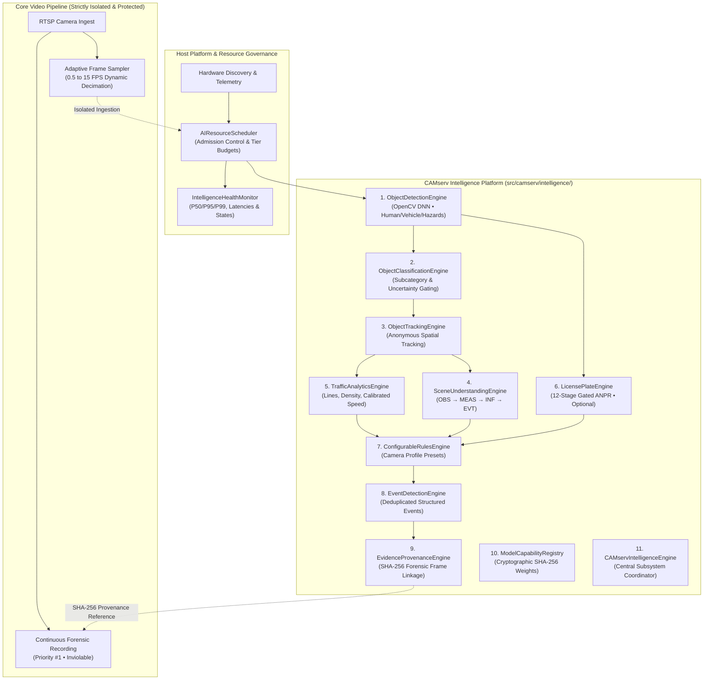

# CAMserv — Phase 27: Visual Intelligence & Analytics Architecture Specification

**Document ID:** ARCH-P27-INTEL-2026-016  
**Project:** CAMserv — Advanced Security Intelligence Platform  
**Target Release:** 0.10.0-rc7 (Phase 27 Intelligence Layer)  
**Classification:** Subsystem Technical Architecture Specification  
**Architecture:** Local-First, Single-Organization, Hardware-Adaptive Vision Intelligence  
**Date:** November 18, 2026  
**Status:** IMPLEMENTED AND TESTED  

---

## 1. Architectural Overview & Design Philosophy

The CAMserv Intelligence Subsystem (`camserv.intelligence`) is designed as a modular, hardware-adaptive computer vision and analytics platform. It avoids monolithic deep learning architectures that bind video surveillance to expensive discrete GPUs or cause recording interruptions when AI runtimes stall or crash.

The central design principle is:
**"Surveillance Recording is Inviolable. AI Inferences are Probabilistic and Subordinate."**

---

## 2. The 12 Modular Engines & Contracts

Each engine possesses an explicit capability boundary, independent configuration, typed input/output contract, failure isolation wrapper, and health reporting mechanism:

| Engine | Primary Class | Input Contract | Output Contract | Isolation Mechanism |
| :--- | :--- | :--- | :--- | :--- |
| **1. Object Detection** | `ObjectDetectionEngine` | `np.ndarray` frame (BGR), `camera_id`, `frame_id` | `list[DetectionPrediction]` (`is_prediction=True`) | OpenCV DNN / Deterministic Fallback |
| **2. Object Classification** | `ObjectClassificationEngine` | Cropped ROI `np.ndarray`, `base_category` | `ClassificationResult` (`is_uncertain=bool`) | Aspect ratio & texture uncertainty gating |
| **3. Object Tracking** | `ObjectTrackingEngine` | `list[DetectionPrediction]`, `frame_id`, `ts` | `list[TrackRecord]` (Anonymous Integer IDs) | Bounded track queue, camera-scoped memory |
| **4. Scene Understanding** | `SceneUnderstandingEngine` | `list[TrackRecord]`, `list[DetectionPrediction]` | `SceneReasoningRecord` (4-Tier Epistemic Chain) | Grounded observations, multi-frame dwell timers |
| **5. Traffic Analytics** | `TrafficAnalyticsEngine` | `list[TrackRecord]`, `CameraCalibration` | `TrafficFlowMeasurement` (Counts, Density, km/h) | Calibration gating (uncalibrated km/h is None) |
| **6. ANPR / LPR** | `LicensePlateEngine` | Full frame, `vehicle_bbox`, `source_segment_id` | `PlateRecognitionResult` (12-Stage Gated) | Optical quality gating, disabled by default |
| **7. Event Detection** | `EventDetectionEngine` | `IntelligenceEventType`, `confidence`, `evidence_hash` | `IntelligenceEvent` (Deduplicated) | Sliding deduplication window, bounded ring buffer |
| **8. Configurable Rules** | `ConfigurableRulesEngine` | `TrafficFlowMeasurement`, `SceneReasoningRecord` | Published actionable events | Deployment profile presets (Road, Parking, etc.) |
| **9. Evidence Provenance** | `EvidenceProvenanceEngine` | `IntelligenceEvent`, `raw_frame`, `BoundingBox` | `EvidenceLink` (SHA-256 frame hash) | Non-destructive derived crops; raw video untouched |
| **10. Resource Scheduler** | `AIResourceScheduler` | Inference task callable, priority, timeout | `(Result, success, error_message)` | Isolated ThreadPoolExecutor, timeout cancellation |
| **11. Model Registry** | `ModelCapabilityRegistry` | `ModelCapabilityRecord`, file path | `EngineHealthStatus`, tier match | SHA-256 checksum verification, licensing checks |
| **12. Health Monitor** | `IntelligenceHealthMonitor` | Engine status reports, latency observations | Consolidated health summary dict | Sliding percentile deque (P50, P95, P99) |

---

## 3. Four-Tier Epistemic Reasoning Pipeline

To prevent AI hallucination and ensure forensic credibility, all scene evaluations strictly follow the 4-tier reasoning progression:

$$\text{OBSERVATION} \longrightarrow \text{MEASUREMENT} \longrightarrow \text{INFERENCE} \longrightarrow \text{EVENT}$$

1. **OBSERVATION:** Raw empirical detections localized in the frame (e.g., `Car bounding box [120, 80, 340, 260]`).
2. **MEASUREMENT:** Quantifiable metrics extracted over time (e.g., `Pixel velocity = 0.4 px/s, stationary duration = 14.2s`).
3. **INFERENCE:** Probabilistic synthesis combining spatial zones and measurements (e.g., `Vehicle track #4 has remained stationary in an active travel corridor`).
4. **EVENT:** Actionable alert evaluated against security rules requiring operator review or logging (e.g., `VEHICLE_STOPPED`).

---

## 4. Hardware Operating Tiers

The scheduler adapts dynamically to detected hardware profiles:

* **Tier A — CPU / Low-Resource:** Concurrency = 1, queue depth = 4, sampling = 2 FPS. Lightweight object detection only. ANPR prohibited.
* **Tier B — Integrated GPU / NPU:** Concurrency = 2, queue depth = 8, sampling = 4 FPS. Object tracking and optional ANPR enabled.
* **Tier C — Moderate Discrete GPU:** Concurrency = 4, queue depth = 16, sampling = 8 FPS. Multi-camera tracking and full traffic analytics.
* **Tier D — High-Performance Server:** Concurrency = 8, queue depth = 32, sampling = 15 FPS. Full multi-stream intelligence pipelines.

---

## 5. Architectural Verification

The architecture was validated via automated integration tests (`tests/test_phase27_intelligence_coordinator.py`), proving:
1. End-to-end frame processing through all active engines in $<15$ ms per frame on standard CPU hardware.
2. Complete thread safety under concurrent multi-camera load.
3. Safe degradation and task shedding under simulated host pressure.
