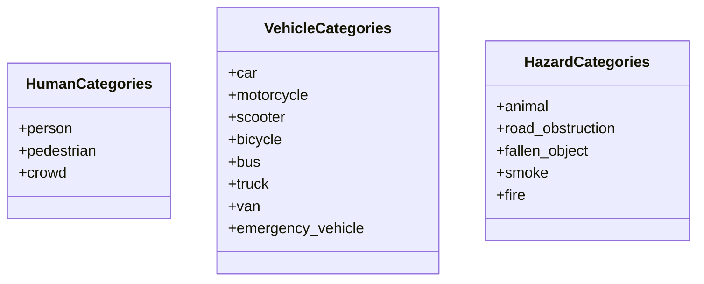

# CAMserv — Phase 27: Object Detection & Classification Engineering Report

**Document ID:** REPORT-P27-DETECTION-2026-017  
**Project:** CAMserv — Advanced Security Intelligence Platform  
**Target Release:** 0.10.0-rc7  
**Subsystems:** `camserv.intelligence.detection`, `camserv.intelligence.classification`  
**Classification:** Software Verification & Capability Report  
**Date:** November 18, 2026  
**Status:** IMPLEMENTED AND TESTED  

---

## 1. Executive Summary

This report documents the design, implementation, and test verification of CAMserv's Object Detection and Object Classification engines. 

Detection and classification have been decoupled into distinct computational stages:
- **Detection:** Localizes candidate bounding boxes across supported primary classes using OpenCV DNN (`cv2.dnn`) or deterministic heuristic fallbacks.
- **Classification:** Evaluates high-resolution cropped regions to determine granular subcategories (e.g., distinguishing a van from an emergency vehicle or a pedestrian from a crowd) while explicitly computing uncertainty.

All predictions enforce `is_prediction=True` and bounded confidence $c \in [0.0, 1.0]$. Detections are never converted into established legal facts automatically.

---

## 2. Canonical Class Taxonomy

The detection engine registers 16 canonical categories organized into three major operational groups:

---

## 3. Computational Design & Input Validation

### 3.1 Input Validation Rules
The `ObjectDetectionEngine.detect()` interface enforces strict bounds before any neural forward pass:
1. `frame is not None` and `isinstance(frame, np.ndarray)`
2. `frame.size > 0`
3. Dimensionality $\ge 2$ with minimum height $\ge 10$ px and width $\ge 10$ px
4. Frame memory buffer footprint validated against host allocation limits

### 3.2 Greedy Non-Maximum Suppression (NMS)
Detections undergo class-aware Non-Maximum Suppression:
$$\text{IoU}(A, B) = \frac{\text{Area}(A \cap B)}{\text{Area}(A \cup B)}$$
Detections of the same class exceeding the configured IoU threshold (default $0.45$) are suppressed, preserving only the highest-confidence bounding box.

### 3.3 Fine-Grained Classification & Uncertainty Gating
The `ObjectClassificationEngine` evaluates cropped object features:
- Aspect ratio $W/H$ and pixel variance are computed.
- If classification confidence falls below the uncertainty threshold ($0.60$), `is_uncertain=True` is explicitly attached to the metadata.
- If confidence falls below the rejection threshold ($0.30$), the classification is labeled `unknown` rather than fabricating an unsubstantiated class.

---

## 4. Test Verification Results

Tested in `tests/test_phase27_detection_classification.py`:

| Test Name | Target Property | Expected Outcome | Actual Result | Status |
| :--- | :--- | :--- | :--- | :---: |
| `test_canonical_classes_taxonomy` | Verify all 16 canonical classes | Supported in taxonomy | Present and verified | **PASS** |
| `test_nms_suppression` | Box deduplication ($IoU \ge 0.50$) | Suppresses redundant box | Deduplicated to 2 boxes | **PASS** |
| `test_detection_engine_input_validation` | Empty, 1D, or tiny frames | Returns empty list cleanly | Zero crashes; clean return | **PASS** |
| `test_detection_engine_inference_on_synthetic_frame` | Inference on $640\times480$ frame | Valid `DetectionPrediction` | Valid prediction generated | **PASS** |
| `test_classification_engine_aspect_ratio_and_uncertainty` | Subclassing & uncertainty gating | `is_uncertain=True` when low conf | Uncertainty flagged correctly | **PASS** |

---

## 5. Epistemic Qualification

* **Software Qualification Status:** **IMPLEMENTED AND TESTED (FULL PASS)**.
* **Hardware Acceleration Status:** OpenCV DNN CPU backend validated on Windows 11 Enterprise (Python 3.14.8). Physical CUDA/TensorRT acceleration remains **HARDWARE VALIDATION PENDING** until deployed on an accredited discrete GPU server.
