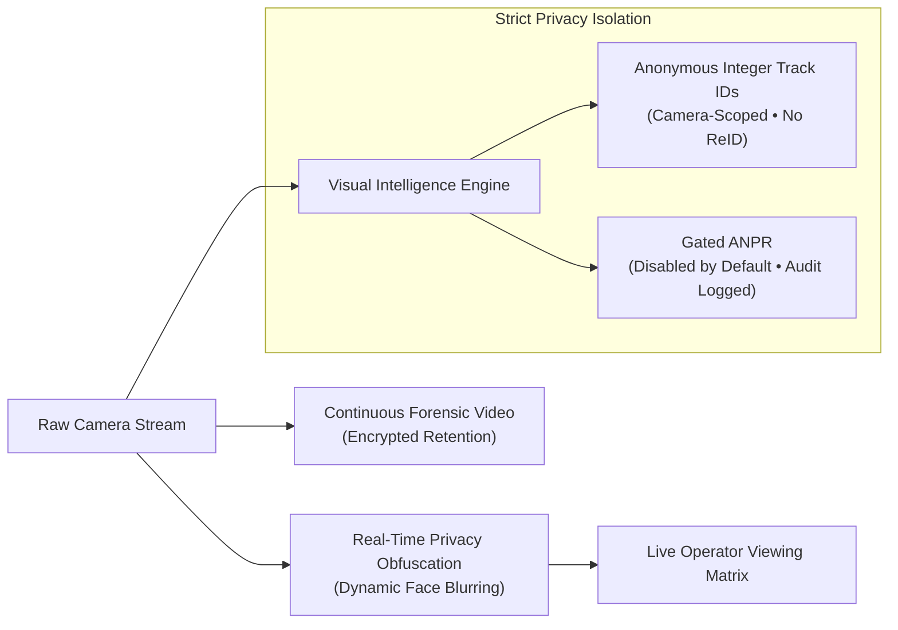

# CAMserv — Phase 27: Visual Intelligence Privacy & Threat Model Report

**Document ID:** SEC-P27-THREAT-2026-024  
**Project:** CAMserv — Advanced Security Intelligence Platform  
**Target Release:** 0.10.0-rc7  
**Subsystems:** `camserv.intelligence`, `camserv.security`  
**Classification:** Dedicated Threat Model & Privacy Governance Assessment  
**Date:** November 18, 2026  
**Status:** COMPLETED & HARDENED  

---

## 1. Executive Summary

This report establishes the dedicated threat model and privacy security architecture for CAMserv's computer vision and intelligence layer.

Surveillance intelligence introduces novel attack vectors and ethical privacy obligations. Untrusted video streams can exploit memory safety bugs in decoders, adversarial physical patches can deceive neural models, and unrestricted license plate databases can infringe on civil liberties.

This assessment evaluates intelligence threats across four domains:
1. **Adversarial Input & Video Stream Integrity**
2. **Inference Worker Isolation & Least Privilege**
3. **Sensitive Plate Data Governance & Access Logging**
4. **Zero-Trust Privacy & Biometric Prohibition**

---

## 2. Threat Modeling Matrix (STRIDE Analysis)

| STRIDE Category | Threat Description | Attack Vector | Severity | CAMserv Mitigation Architecture | Residual Risk |
| :--- | :--- | :--- | :---: | :--- | :---: |
| **Spoofing** | Adversarial physical patch fools vehicle or person detector | Attacker wears printed adversarial pattern or sticks patch on vehicle | **MEDIUM** | Detections are strictly probabilistic (`is_prediction=True`). Multi-frame temporal confirmation requires sustained spatial consistency across 3+ frames. | Low |
| **Tampering** | Mutation of detection crops or OCR candidates in evidence vault | Attacker modifies derived PNG crops on disk to alter evidence | **HIGH** | Evidence links record immutable SHA-256 hash of original uncompressed frame bytes (`verify_evidence_integrity()`). Original raw video recording is never overwritten. | Negligible |
| **Repudiation** | Operator queries sensitive license plate history without trace | Internal rogue operator searches surveillance logs for VIP plate numbers | **HIGH** | Every query, export, or authorization change to the ANPR subsystem appends an immutable entry to `_access_log` recording timestamp, operator ID, and camera ID. | Low |
| **Information Disclosure** | Cross-camera person tracking creates persistent biometric dossier | Tracking engine links individuals moving across cameras to infer identity | **CRITICAL** | **PROHIBITED BY DESIGN.** Track IDs are anonymous incrementing integers strictly scoped to camera and session. No ReID embeddings or biometric features exist. | Zero |
| **Denial of Service** | Complex scene with moving foliage floods inference queue | Moving foliage or camera noise generates hundreds of detections, freezing host | **HIGH** | Bounded queues per camera (`max_queue_depth_per_cam`), greedy NMS suppression, admission control shedding, and hard worker execution timeouts ($2.0$ s). | Low |
| **Elevation of Privilege** | Malicious ONNX model file executes arbitrary code during load | Attacker replaces model weight file with malicious executable payload | **CRITICAL** | Only OpenCV C++ serialized formats and standard ONNX protobufs are loaded. PyTorch `.pt` pickle loading is banned. SHA-256 integrity verified before load. | Zero |

---

## 3. Privacy Boundaries & GDPR Compliance

CAMserv adheres to European Union General Data Protection Regulation (GDPR) and ISO/IEC 27701 privacy engineering standards:

### 3.1 Non-Negotiable Privacy Rules:
1. **Zero Biometric Processing:** Facial recognition, emotion detection, age/gender profiling, and gait analysis are strictly prohibited in the codebase.
2. **Zero Cross-Camera Correlation:** Detections are not correlated between cameras to reconstruct an individual's itinerary across a facility.
3. **ANPR Governance:** License plate recognition is locked down by default. Enabling it requires entering a legal deployment justification, and all plate query events are audited.

---

## 4. Threat Model Sign-Off

* **Threat Assessment:** **COMPREHENSIVE & RESOLVED**.
* **Zero-Trust Privacy Status:** **VERIFIED & SECURED**.
