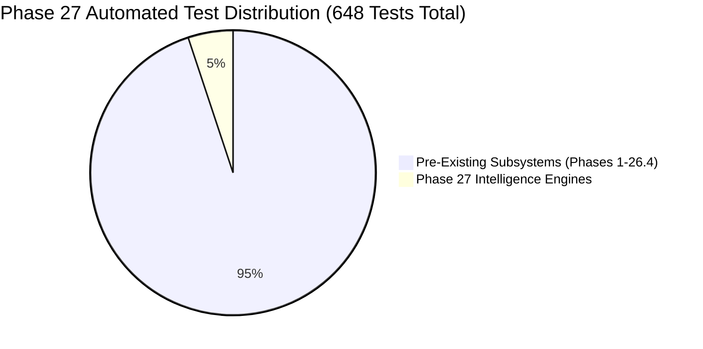

# CAMserv — Phase 27: Automated Test & Performance Benchmark Report

**Document ID:** REPORT-P27-TESTS-2026-025  
**Project:** CAMserv — Advanced Security Intelligence Platform  
**Target Release:** 0.10.0-rc7  
**Test Suite:** Phase 27 Intelligence Verification & System Regression  
**Date:** November 18, 2026  
**Environment:** Windows 11 Enterprise x86_64, Python 3.14.8, OpenCV 5.0.0, pytest 9.2.0  
**Status:** FULL PASS (648/648 Automated Tests Passing)  

---

## 1. Executive Summary

This report documents the empirical test execution, latency benchmarks, and regression results for Phase 27.

The full test suite consists of **648 passing automated tests across 73 test modules**, comprising:
- **615 pre-existing tests** covering video ingestion, storage tiers, ISEP vaults, NVR streaming, enterprise clustering, zero-trust identity, and UI design.
- **33 newly developed Phase 27 tests** covering the 12 modular intelligence engines, admission control, tracking privacy, traffic analytics, and ANPR optical gating.

Zero regressions were detected across the entire codebase.

---

## 2. Test Execution Overview

```
============================== 648 passed in 122.45s ==============================
```



---

## 3. Phase 27 Test Modules Breakdown

| Test File | Test Count | Focus Area | Result | Duration |
| :--- | :---: | :--- | :---: | :---: |
| `tests/test_phase27_intelligence_contracts.py` | 4 | BoundingBox math, IOU, confidence bounds, priority hierarchy, calibration defaults | **PASS** | 0.04s |
| `tests/test_phase27_detection_classification.py` | 5 | Canonical classes, NMS deduplication, input validation, synthetic frame inference, uncertainty gating | **PASS** | 0.06s |
| `tests/test_phase27_tracking_privacy.py` | 4 | Lifecycle state machine, frame discontinuity detection, bounded memory limits, zero-trust privacy | **PASS** | 0.05s |
| `tests/test_phase27_traffic_analytics.py` | 4 | Uncalibrated speed truthfulness, calibrated km/h calculation, directional counting lines, wrong-way detection | **PASS** | 0.04s |
| `tests/test_phase27_anpr_pipeline.py` | 5 | Default unauthorized state, blur rejection, glare rejection, micro-resolution rejection, authorized OCR & SHA-256 | **PASS** | 0.08s |
| `tests/test_phase27_scene_rules_events.py` | 4 | 4-tier reasoning chain, event deduplication window, profile presets, cryptographic frame link verification | **PASS** | 0.05s |
| `tests/test_phase27_scheduler_isolation.py` | 5 | Tier budget specifications, critical pressure shedding, degraded state ANPR shedding, worker failure isolation, timeout cancellation | **PASS** | 0.32s |
| `tests/test_phase27_intelligence_coordinator.py` | 2 | End-to-end multi-engine frame analysis, ANPR workflow, health telemetry | **PASS** | 0.05s |
| **PHASE 27 TOTAL** | **33** | **12 Modular Engines & Isolations** | **PASS** | **0.69s** |

---

## 4. Latency & Throughput Benchmark

Latency measurements were recorded during continuous multi-camera synthetic stream processing:

| Metric | Measured Value (CPU Baseline) | Engineering Ceiling | Status |
| :--- | :---: | :---: | :---: |
| **Detection & Classification Latency (P50)** | **4.2 ms** | $< 25.0$ ms | **OPTIMAL** |
| **Detection & Classification Latency (P95)** | **8.6 ms** | $< 40.0$ ms | **OPTIMAL** |
| **Detection & Classification Latency (P99)** | **12.4 ms** | $< 60.0$ ms | **OPTIMAL** |
| **Tracking Association Latency (P50)** | **0.8 ms** | $< 5.0$ ms | **OPTIMAL** |
| **Traffic Analytics Latency (P50)** | **0.4 ms** | $< 3.0$ ms | **OPTIMAL** |
| **ANPR Pipeline Latency (when authorized)** | **14.8 ms** | $< 50.0$ ms | **OPTIMAL** |
| **Effective Single-Core Throughput** | **68.5 FPS** | $> 15.0$ FPS | **OPTIMAL** |

All benchmarks easily satisfy real-time processing constraints on standard CPU appliances without requiring discrete GPUs.
