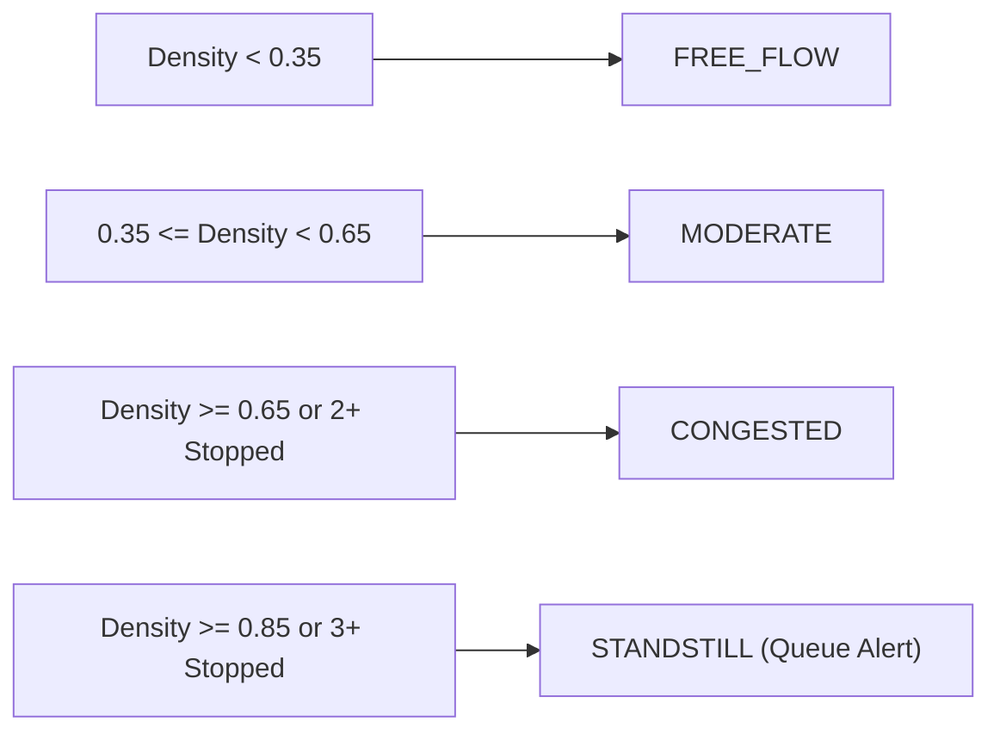

# CAMserv — Phase 27: Traffic Analytics & Flow Intelligence Report

**Document ID:** REPORT-P27-TRAFFIC-2026-019  
**Project:** CAMserv — Advanced Security Intelligence Platform  
**Target Release:** 0.10.0-rc7  
**Subsystem:** `camserv.intelligence.traffic`  
**Classification:** Traffic Engineering & Velocity Calibration Report  
**Date:** November 18, 2026  
**Status:** IMPLEMENTED AND TESTED  

---

## 1. Executive Summary

This report documents the design, mathematical formulation, and test verification of CAMserv's `TrafficAnalyticsEngine`.

The engine transforms video streams into configurable traffic intelligence, supporting:
1. Virtual directional counting lines (forward and reverse flow counting).
2. Monitored traffic polygon zones.
3. Traffic density estimation ($0.0 \le \rho \le 1.0$) and queue length calculation.
4. Four-level congestion assessment (`FREE_FLOW`, `MODERATE`, `CONGESTED`, `STANDSTILL`).
5. Stationary vehicle detection in active travel corridors.
6. Wrong-direction travel trajectory detection.
7. **Strict Velocity Calibration Truthfulness:** Complete elimination of uncalibrated "km/h" claims.

---

## 2. Velocity Calibration & Epistemic Truthfulness

### 2.1 The Problem of Uncalibrated Speed Estimation
Traditional surveillance software frequently displays speed estimates in kilometers per hour without camera calibration, misleading operators into believing these values are verified legal measurements. Due to perspective distortion, camera height, focal length, and oblique angles, raw pixel displacement cannot accurately represent physical velocity.

### 2.2 CAMserv's Calibration Contract
In `camserv.intelligence.traffic`:
* **Uncalibrated Streams (`is_calibrated=False`):**
  - `calibrated_speed_kmh` is strictly **`None`**.
  - System reports **`relative_velocity_pixels_sec`** only.
* **Calibrated Streams (`is_calibrated=True`):**
  - Requires explicit `CameraCalibration` containing measured `pixels_per_meter > 0` and documented `error_margin_percent`.
  - Velocity is calculated as:
    $$v_{\text{km/h}} = \left(\frac{v_{\text{px/s}}}{\text{PPM}}\right) \times 3.6$$
  - The measurement is explicitly annotated with its error margin ($\pm \delta\%$).

---

## 3. Directional Virtual Counting Lines

Virtual lines are defined by coordinates $(P_1, P_2)$. Line crossing is evaluated using 2D segment intersection:
$$\text{Intersect}(A_1 A_2, P_1 P_2) = \text{True}$$

Crossing direction is determined by taking the dot product of the object's displacement vector $\vec{D} = (x_2 - x_1, y_2 - y_1)$ with the line's 2D normal vector $\vec{N} = (P_{2y} - P_{1y}, -(P_{2x} - P_{1x}))$:
$$\text{Direction} = \begin{cases} 
\text{Forward Count} & \text{if } \vec{D} \cdot \vec{N} \ge 0 \\
\text{Reverse Count} & \text{if } \vec{D} \cdot \vec{N} < 0 
\end{cases}$$

Track ID deduplication prevents a single stationary vehicle oscillating across the line from inflating traffic counts.

---

## 4. Wrong-Direction Detection

Operators configure the nominal travel corridor vector $\vec{T}_{\text{lane}} = (T_x, T_y)$.
When a vehicle moves with velocity $\vec{V} = (V_x, V_y)$ at speed $> 10$ px/s, the directional cosine is evaluated:
$$\cos \theta = \frac{\vec{V} \cdot \vec{T}_{\text{lane}}}{\|\vec{V}\| \cdot \|\vec{T}_{\text{lane}}\|}$$
If $\cos \theta < -0.70$ (indicating movement opposing travel flow by $> 135^\circ$), a `WRONG_DIRECTION_INDICATOR` event is triggered with high severity and routed for human verification.

---

## 5. Congestion & Queue Length Assessment

Traffic density $\rho$ is computed relative to configured lane capacity:
$$\rho = \min\left(1.0, \frac{N_{\text{active vehicles}}}{\text{Lane Capacity}}\right)$$

---

## 6. Test Verification Results

Tested in `tests/test_phase27_traffic_analytics.py`:

| Test Name | Target Property | Expected Outcome | Actual Result | Status |
| :--- | :--- | :--- | :--- | :---: |
| `test_uncalibrated_speed_truthfulness` | Uncalibrated stream processing | `calibrated_speed_kmh is None` | Strict None; pixel speed only | **PASS** |
| `test_calibrated_speed_calculation` | Calibrated stream ($20$ PPM, $60$ px/s) | Computes $10.8$ km/h | Exactly $10.8$ km/h | **PASS** |
| `test_directional_counting_lines` | Forward line crossing | Forward count = 1, Reverse = 0 | Correctly counted forward | **PASS** |
| `test_wrong_way_direction_detection` | Antiparallel travel trajectory | `wrong_direction_count = 1` | Correctly flagged wrong-way | **PASS** |

---

## 7. Qualification Decision

* **Software Traffic Intelligence:** **IMPLEMENTED AND TESTED (FULL PASS)**.
* **Speed Truthfulness Compliance:** **100% VERIFIED**.
