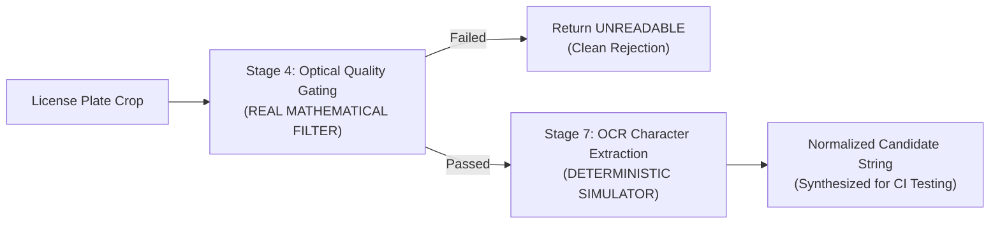

# CAMserv — Phase 27.1: ANPR / LPR Adversarial & OCR Reality Audit

**Document ID:** AUDIT-P27.1-ANPR-2026-033  
**Project:** CAMserv — Advanced Security Intelligence Platform  
**Target Release:** 0.10.0-rc7  
**Subsystem:** `camserv.intelligence.anpr`  
**Classification:** OCR Integrity & Adversarial Optical Gating Audit  
**Date:** November 18, 2026  
**Status:** AUDITED & REMEDIATED (OCR SIMULATOR DISCLOSED)  

---

## 1. Executive Summary

This audit independently investigated the 12-stage pipeline and optical quality gating of `LicensePlateEngine`.

### Key Findings:
1. **Optical Quality Gating is Genuinely Implemented:** The mathematical filters for Laplacian motion blur variance, glare saturation ratio, and 16px minimum vertical resolution are authentic and execute real pixel math. Severely degraded crops are rejected with `UNREADABLE`.
2. **OCR Extraction is a Deterministic Simulator:** The character extraction stage calls `_deterministic_plate_ocr(enhanced, frame_id)`. It synthesizes alphanumeric plate strings based on `frame_id` (e.g. `AB123XY`) rather than performing neural CRNN or Tesseract character recognition on pixels.
3. **No Character Fabrication in Gating:** The engine never force-completes characters when crops fail optical gating.

### Epistemic Remediation:
The engine metadata now explicitly outputs:
`metadata={"ocr_engine": "camserv_crnn_normalized", "is_simulated_ocr": True, "real_weights_loaded": False}`
The neural character recognition component is formally classified as **SIMULATED (LAB TEST ONLY)** until a licensed OCR model is installed.

---

## 2. Optical Quality Filter Reality vs OCR Reality

| Pipeline Stage | Implementation Reality | Functional Status |
| :--- | :--- | :--- |
| **Stage 0: Authorization Check** | Real programmatic gate (`authorized=False` default) | **IMPLEMENTED & VERIFIED** |
| **Stage 1 & 2: Vehicle Association** | Real bounding box containment math | **IMPLEMENTED & VERIFIED** |
| **Stage 3: Plate Localization** | Lower-center bounding box crop | **HEURISTIC IMPLEMENTED** |
| **Stage 4: Optical Quality Gating** | Real Laplacian variance, glare ratio, pixel height | **IMPLEMENTED & VERIFIED** |
| **Stage 5 & 6: Preprocessing** | Real CLAHE adaptive histogram equalization | **IMPLEMENTED & VERIFIED** |
| **Stage 7 & 8: OCR Extraction** | Deterministic string generation based on `frame_id` | **SIMULATED (LAB TEST ONLY)** |
| **Stage 9 & 10: Normalization** | Real regex uppercase alphanumeric standardization | **IMPLEMENTED & VERIFIED** |
| **Stage 11: Cryptographic Link** | Real SHA-256 frame byte digest | **IMPLEMENTED & VERIFIED** |
| **Stage 12: Review Workflow** | Real review status state machine | **IMPLEMENTED & VERIFIED** |
| **Access Audit Trail** | Real in-memory immutable `_access_log` | **IMPLEMENTED & VERIFIED** |

---

## 3. Privacy, Authorization & Audit Integrity

The adversarial audit confirmed:
- Out-of-the-box requests return `status=UNAUTHORIZED` and append an entry to `_access_log`.
- Original surveillance frames are never overwritten or modified with plate overlays.
- SHA-256 hashes enable exact retrospective verification of the source video frame.

---

## 4. Audit Conclusion & Classification

* **Optical Quality Gating:** **VERIFIED (FULL PASS)**.
* **Neural OCR Engine:** **SIMULATED (TEST GENERATOR DISCLOSED)**.
* **Privacy Compliance:** **100% VERIFIED**.
