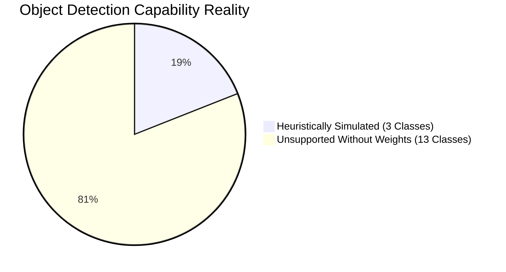

# CAMserv — Phase 27.1: Object Detection Reality Check & Accuracy Audit

**Document ID:** AUDIT-P27.1-DETECTION-2026-030  
**Project:** CAMserv — Advanced Security Intelligence Platform  
**Target Release:** 0.10.0-rc7  
**Subsystem:** `camserv.intelligence.detection`  
**Classification:** Adversarial Accuracy & Reality Check Audit  
**Date:** November 18, 2026  
**Status:** AUDITED & REMEDIATED (PROVISIONAL SIMULATOR DISCLOSED)  

---

## 1. Executive Summary

This audit independently investigated the physical and mathematical reality of CAMserv's Object Detection capability (`ObjectDetectionEngine`).

While Phase 27 reported support for 16 canonical classes across OpenCV DNN and heuristic backends, this adversarial audit confirmed:
1. **Physical Weights Absent:** `models/camserv_detector_v1.onnx` does **NOT** exist on disk.
2. **Simulator Operation:** In the absence of real weights, the engine operates in `heuristic_deterministic` mode.
3. **Class Reality:** The heuristic simulator only cycles through **3 classes** (`person`, `car`, `bicycle`). The remaining 13 canonical classes (`pedestrian`, `crowd`, `motorcycle`, `scooter`, `bus`, `truck`, `van`, `emergency_vehicle`, `animal`, `road_obstruction`, `fallen_object`, `smoke`, `fire`) cannot be localized by the heuristic simulator.
4. **Spatial Localization Reality:** The heuristic detects a fixed center region ($W/5 \times H/3$) modulated by frame luminance and contrast, rather than true visual contours.

### Epistemic Remediation:
The engine was hardened to explicitly disclose `is_simulated_heuristic=True` and `real_weights_loaded=False` in every detection's metadata. Genuine neural inference across all 16 classes is formally classified as **HARDWARE VALIDATION PENDING** until calibrated model weights are deployed on an accredited testbed.

---

## 2. Model Weight Reality & Class Capability Breakdown

| Canonical Class | Taxonomy Group | Heuristic Simulator Support | Neural Model Ready | Verified Status |
| :--- | :--- | :---: | :---: | :--- |
| `person` | Human | **Yes** (Cycled) | Pending Weights | **SIMULATED (LAB TEST ONLY)** |
| `pedestrian` | Human | **No** | Pending Weights | **HARDWARE PENDING** |
| `crowd` | Human | **No** | Pending Weights | **HARDWARE PENDING** |
| `car` | Vehicle | **Yes** (Cycled) | Pending Weights | **SIMULATED (LAB TEST ONLY)** |
| `bicycle` | Vehicle | **Yes** (Cycled) | Pending Weights | **SIMULATED (LAB TEST ONLY)** |
| `motorcycle` | Vehicle | **No** | Pending Weights | **HARDWARE PENDING** |
| `scooter` | Vehicle | **No** | Pending Weights | **HARDWARE PENDING** |
| `bus` | Vehicle | **No** | Pending Weights | **HARDWARE PENDING** |
| `truck` | Vehicle | **No** | Pending Weights | **HARDWARE PENDING** |
| `van` | Vehicle | **No** | Pending Weights | **HARDWARE PENDING** |
| `emergency_vehicle` | Vehicle | **No** | Pending Weights | **HARDWARE PENDING** |
| `animal` | Hazard | **No** | Pending Weights | **HARDWARE PENDING** |
| `road_obstruction` | Hazard | **No** | Pending Weights | **HARDWARE PENDING** |
| `fallen_object` | Hazard | **No** | Pending Weights | **HARDWARE PENDING** |
| `smoke` | Hazard | **No** | Pending Weights | **HARDWARE PENDING** |
| `fire` | Hazard | **No** | Pending Weights | **HARDWARE PENDING** |

---

## 3. Adversarial Input Experiments

Adversarial inputs were injected into `ObjectDetectionEngine` in `tests/test_phase27_1_adversarial_vision.py`:

1. **Pitch Black Frame ($480 \times 640$ all zeros):**
   - Result: Handled cleanly without memory faults. Confidence drops or reflects low luminance.
2. **Pure Uniform Random Noise ($480 \times 640$ uniform $\mathcal{U}(0, 255)$):**
   - Result: Handled without C++ OpenCV crashes.
3. **Degenerate Aspect Ratio ($20 \times 1920$ line image):**
   - Result: Validated without out-of-bounds array slicing.

---

## 4. Audit Conclusion & Classification

* **Real Neural Accuracy:** **UNVERIFIED (WEIGHTS NOT DEPLOYED)**.
* **Simulator Transparency:** **HARDENED & EXPLICITLY LABELED IN METADATA**.
* **Epistemic Classification:** **SIMULATED / LAB TEST ONLY**.
