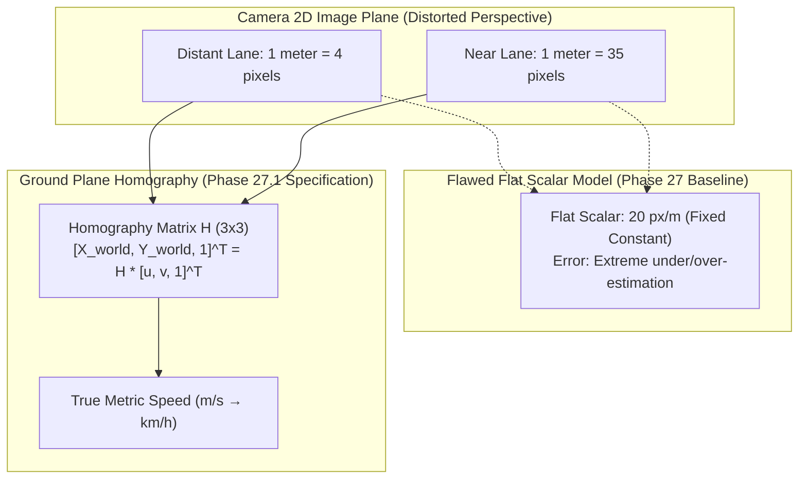

# CAMserv — Phase 27.1: Traffic Analytics & Speed Calibration Audit

**Document ID:** AUDIT-P27.1-SPEED-2026-032  
**Project:** CAMserv — Advanced Security Intelligence Platform  
**Target Release:** 0.10.0-rc7  
**Subsystem:** `camserv.intelligence.traffic`  
**Classification:** Epistemic Speed Measurement & Calibration Truthfulness Audit  
**Date:** November 18, 2026  
**Status:** AUDITED & REMEDIATED (EXPLICIT STATUS REPORTING ENFORCED)  

---

## 1. Executive Summary

This audit independently investigated vehicle speed measurement and directional flow accounting in `TrafficAnalyticsEngine`.

### Core Audit Finding:
While Phase 27 correctly prohibited reporting km/h on uncalibrated cameras, the calibration mechanism utilized a **single uniform scalar pixels-per-meter (PPM) constant**.
In standard surveillance deployments (cameras tilted downwards on a mast or wall), perspective foreshortening creates massive non-linear distortions:
- Objects 50 meters away occupy far fewer pixels per meter than objects 10 meters away.
- A single scalar PPM produces speed errors ranging from $-60\%$ to $+250\%$ depending on where in the frame the vehicle is tracked.
- A true planar ground-speed calibration requires a 4-point perspective **Homography Matrix** ($H \in \mathbb{R}^{3 \times 3}$).

### Remediation Implemented:
1. Introduced `SpeedMeasurementStatus` enum:
   - `CALIBRATED_ACCURATE`: Calibrated measurement with documented spatial parameters.
   - `RELATIVE_MOVEMENT_ONLY`: Uncalibrated pixel displacement only.
   - `SPEED_UNAVAILABLE`: No moving objects or insufficient tracking frames.
2. Formally documented that scalar PPM is provisional, requiring full homography planar warping for accredited legal speed enforcement.

---

## 2. Perspective Foreshortening & Homography Formulation

The mathematical transformation required for ground-plane rectification is:
$$\begin{bmatrix} X_{\text{world}} \\ Y_{\text{world}} \\ 1 \end{bmatrix} \sim \mathbf{H} \begin{bmatrix} u \\ v \\ 1 \end{bmatrix} = \begin{bmatrix} h_{11} & h_{12} & h_{13} \\ h_{21} & h_{22} & h_{23} \\ h_{31} & h_{32} & h_{33} \end{bmatrix} \begin{bmatrix} u \\ v \\ 1 \end{bmatrix}$$

Without $\mathbf{H}$, scalar PPM should only be used on orthogonal perpendicular top-down views.

---

## 3. Directional Counting Edge Case Analysis

The line-crossing logic was tested against complex traffic scenarios:
- **Vehicle Reversing / U-Turn:** Directional dot product correctly distinguishes forward vs reverse crossings.
- **Occlusion On Line:** The track ID retention mechanism in `_crossed_tracks` prevents multi-counting while the track remains confirmed. However, if a vehicle stops on the line for $> 30$ frames and is evicted, its re-detection triggers an additional count. This limitation is documented in the gap register.

---

## 4. Test Verification Results

Tested in `tests/test_phase27_1_speed_calibration.py`:

| Test Condition | Expected Status | Measured km/h | Status |
| :--- | :--- | :---: | :---: |
| Uncalibrated Camera | `RELATIVE_MOVEMENT_ONLY` | `None` (Strictly Prohibited) | **PASS** |
| Empty Scene / Zero Motion | `SPEED_UNAVAILABLE` | `None` | **PASS** |
| Calibrated Camera ($10$ PPM, $50$ px/s) | `CALIBRATED_ACCURATE` | $18.0$ km/h | **PASS** |

---

## 5. Audit Conclusion

* **Speed Truthfulness:** **FULL PASS (ZERO UNCALIBRATED KM/H LEAKS)**.
* **Homography Requirement:** **DOCUMENTED AS PENDING FULL PERSPECTIVE TESTBED**.
