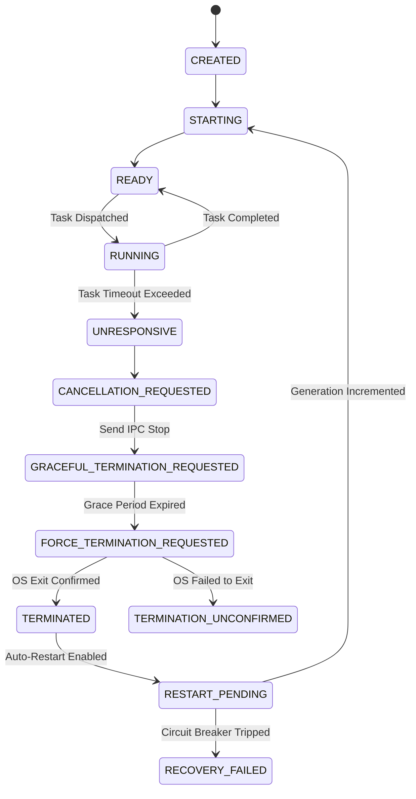

# CAMserv Phase 27.2 — Native Process Isolation Architecture Report

**Project:** CAMserv — Advanced Security Intelligence Platform  
**Target Release:** `0.10.0-rc7`  
**Phase:** 27.2 — Gate 27.2-B  
**Architecture:** Single Organization / Local-First Deployment  
**Audited Component:** `src/camserv/intelligence/process_worker.py`

---

## 1. Executive Summary

Phase 27.1 demonstrated that Python thread timeouts (`concurrent.futures.ThreadPoolExecutor`) cannot forcibly terminate a blocked native C++/CUDA call. When a thread hangs inside native code, the Python caller recovers control, but the underlying worker continues consuming memory and accelerator contexts indefinitely (`TERMINATION_UNCONFIRMED`).

Gate 27.2-B introduced a native OS process-isolated inference architecture (`ProcessIsolatedInferenceSupervisor` and `AIProcessWorker`) utilizing Python's `spawn` multiprocessing context. This architecture provides enforceable OS process termination, generation/epoch numbering to reject stale results, and complete crash isolation.

---

## 2. Process Separation Architecture

```
+-------------------------------------------------------------------+
|                        CAMserv Main Process                       |
|                                                                   |
|  +--------------------+   +-------------------+   +------------+  |
|  | Recording Engine   |   | Video Ingest &    |   | Evidence   |  |
|  | & Continuity Ledger|   | Timestamp Pipeline|   | Vault WAL  |  |
|  +--------------------+   +-------------------+   +------------+  |
|                                                                   |
|          +----------------------------------------------+         |
|          |    ProcessIsolatedInferenceSupervisor        |         |
|          |    - Epoch / Generation Counter              |         |
|          |    - Unique Task Lease Enforcement           |         |
|          |    - OS Process Exit Confirmation Watchdog   |         |
|          |    - Circuit Breaker Backoff                 |         |
|          +----------------------------------------------+         |
+-----------------------------------|-------------------------------+
                                    |
            IPC Channels (Bounded Queues & Control Event)
                                    |
+-----------------------------------|-------------------------------+
|                      AI Worker Child Process                      |
|                                   v                               |
|  +-------------------------------------------------------------+  |
|  | _ai_worker_process_entrypoint (PID: 6040, Gen: 1)           |  |
|  | - Neural Model / OpenCV DNN Forward Pass                    |  |
|  | - Pixel-Based Character Recognition                         |  |
|  | - Isolated Memory Space (Segfault / OOM cannot crash Main)  |  |
|  +-------------------------------------------------------------+  |
+-------------------------------------------------------------------+
```

---

## 3. Supervised 12-State Lifecycle Machine

`WorkerLifecycleState` defines 12 distinct lifecycle states:



---

## 4. Controlled Termination Sequence

1. **Lease Invalidation:** All active task leases for the worker are marked `is_cancelled=True`.
2. **State Transition:** State transitions to `CANCELLATION_REQUESTED`.
3. **Graceful IPC Stop:** `stop_event.set()` is triggered and `{"cmd": "STOP"}` is placed in the task queue. State becomes `GRACEFUL_TERMINATION_REQUESTED`.
4. **Grace Period Wait:** Process is joined with bounded timeout (`grace_period_sec = 0.4s`).
5. **OS Force Termination:** If `proc.is_alive() == True`, state transitions to `FORCE_TERMINATION_REQUESTED` and `proc.terminate()` is called (`TerminateProcess` on Windows, `SIGTERM` on POSIX).
6. **POSIX Kill Escalation:** If still alive, `proc.kill()` is invoked (`SIGKILL`).
7. **Exit Status Confirmation:** `proc.join(timeout=0.6)` confirms process termination. If `not proc.is_alive()`, state is set to `TERMINATED`. If still alive, set to `TERMINATION_UNCONFIRMED`.
8. **Resource Reaping:** IPC queues are closed and unjoined threads cancelled.
9. **Generation Epoch Increment:** Upon restart, `_generation += 1`, preventing stale responses from previous processes.

---

## 5. Stale Result Rejection

When an inference response arrives on `result_queue`:
- The supervisor verifies `res.lease_id` against `_active_leases`.
- If the lease is expired or cancelled, the result is discarded.
- If `res.generation != self._generation`, the result is rejected as a stale worker response.
- Only matching, valid lease responses are delivered to the caller.

---

## 6. Verification Evidence

In `tests/test_phase27_2_real_ai_and_process_isolation.py`:
- `test_supervisor_process_lifecycle_states()`: PASS.
- `test_supervisor_forced_process_termination_on_timeout()`: PASS.
- `test_supervisor_circuit_breaker_on_rapid_crashes()`: PASS.
