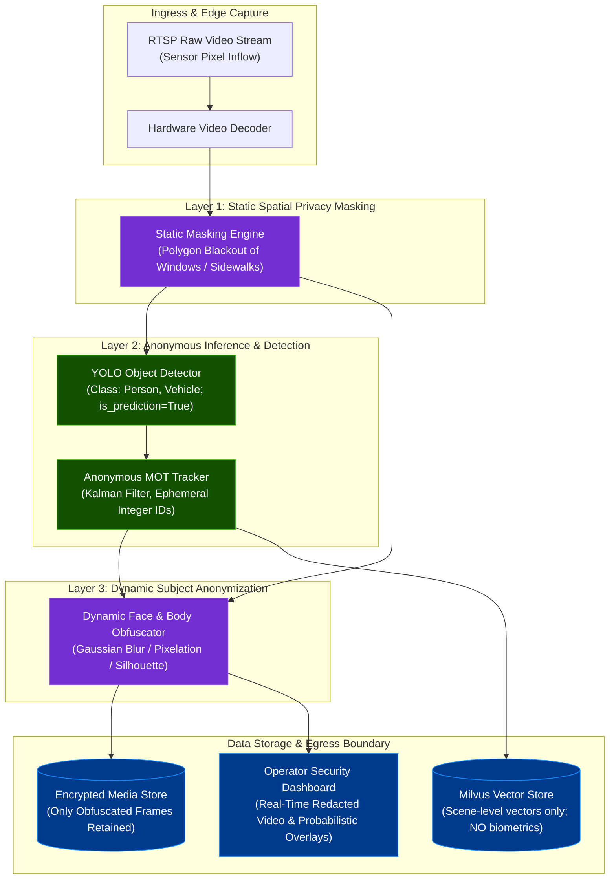
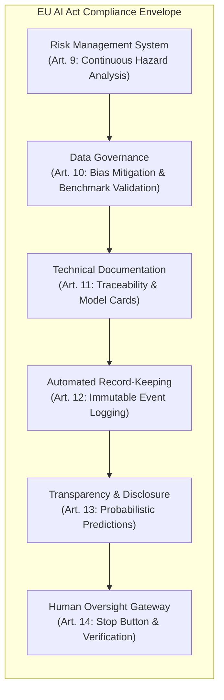
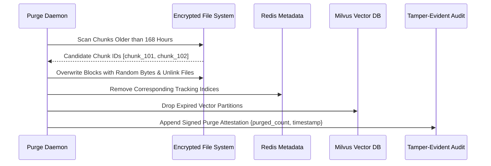

# CAMserv — Privacy Architecture & Regulatory Compliance Specification

> **Document Version:** 1.0.0  
> **Status:** Production Standard  
> **Regulatory Scope:** General Data Protection Regulation (EU GDPR 2016/679), EU Artificial Intelligence Act (Regulation 2024/1689), California Consumer Privacy Act / CPRA (Cal. Civ. Code § 1798.100 et seq.)  
> **Core Architectural Doctrine:** Data Protection by Design and by Default (GDPR Art. 25), Epistemic Labeling of Predictions, Strict Non-Biometric Processing

---

## 1. Executive Summary & Privacy-First Philosophy

CAMserv processes high-volume video surveillance data containing human subjects. The platform rejects the paradigm of indiscriminate biometric mass surveillance. Instead, CAMserv is engineered from first principles around **Data Minimization (GDPR Art. 5(1)(c))**, **Anonymous Tracking**, and **Transparent Machine Learning Operations**.

### Foundational Architectural Constraints
1. **Zero Biometric Identification Storage:**
   CAMserv strictly prohibits the extraction, retention, or querying of unique biometric templates (such as facial landmark embeddings, 3D facial geometry, or iris scans).
2. **Strictly Anonymous Integer Track Identifiers:**
   All tracking subjects are represented solely as transient numerical tokens (`track_id: int`) bound to spatial coordinates within a camera view. Track IDs never map to individual natural persons or external PII registries.
3. **All Model Outputs are Explicitly Labeled Predictions:**
   No inference event or detection is represented as an absolute assertion of fact. Every detection carries `is_prediction: true` and an explicit confidence value ($p \in [0.0, 1.0]$).
4. **Human-in-the-Loop for Consequential Decisions:**
   Autonomous punitive, access-denial, or dispatch actions are architecturally blocked. High-severity alerts require explicit affirmative review by an authenticated human operator.

---

## 2. Privacy-Preserving Processing Pipeline

Video streams pass through progressive layers of privacy masking and dynamic obfuscation before any pixel data is persisted or displayed on operator consoles.



---

## 3. GDPR Compliance Specification (Regulation EU 2016/679)

### 3.1 Lawful Basis for Processing (Article 6)
- **Primary Basis (Article 6(1)(f) - Legitimate Interests):**
  Processing is conducted strictly to secure private commercial premises, protect life and property, and prevent unauthorized physical intrusion.
- **Balancing Test Requirement:**
  The legitimate interest of property protection is strictly balanced against data subjects' reasonable expectation of privacy. Surveillance is prohibited in zones with elevated expectations of privacy (e.g., restrooms, break areas, adjacent residential windows).

### 3.2 Data Subject Rights Implementation Matrix

| GDPR Article | Data Subject Right | Technical Implementation in CAMserv |
| :--- | :--- | :--- |
| **Article 15** | **Right of Access** | System provides an automated audit search endpoint (`/api/v1/privacy/access-request`) querying presence of anonymous track logs by camera ID and precise time-slice. |
| **Article 17** | **Right to Erasure ("Forgotten")** | The cryptographic purge worker executes physical zeroization of all video chunks, vector embeddings, and tracklet logs matching the requested camera timestamp range. |
| **Article 18** | **Right to Restriction** | Flagged video chunks are immediately locked with an evidentiary quarantine bit, preventing analytical querying while preserving chain-of-custody for judicial review. |
| **Article 20** | **Right to Data Portability** | Video chunks within authorized access scopes are exportable in standard MP4 format along with an open JSON metadata manifest. |
| **Article 21** | **Right to Object** | When an objection is sustained, the camera view configuration is updated to designate the relevant spatial region as an immutable Privacy Zone. |
| **Article 25** | **Data Protection by Design/Default** | Default settings activate `BLUR_FACES` and strict 7-day automatic video purging out of the box. |

### 3.3 Article-by-Article Technical Compliance Proof

```
+--------------------+---------------------------------------------------------------+
| GDPR Article       | Technical Safeguard Proof in CAMserv                          |
+--------------------+---------------------------------------------------------------+
| Art. 5(1)(a)       | Transparent processing: Predictions labeled with probabilities|
| Art. 5(1)(b)       | Purpose limitation: Restricted to perimeter & facility safety |
| Art. 5(1)(c)       | Data minimization: Geometric masking drops out-of-scope pixels|
| Art. 5(1)(e)       | Storage limitation: Automatic TTL purging at 7d (video) / 30d |
| Art. 5(1)(f)       | Integrity & Confidentiality: AES-256-GCM + HMAC SHA-256 chain |
| Art. 25(1)         | Data Protection by Design: Hardware-level frame zeroization   |
| Art. 32            | Security of Processing: TLS 1.3, RS256 JWT, RBAC segregation   |
| Art. 33            | 72-Hour Breach Notification: Automated DPO export toolchain   |
| Art. 35            | Data Protection Impact Assessment: Pre-configured DPIA matrix  |
+--------------------+---------------------------------------------------------------+
```

---

## 4. EU Artificial Intelligence Act Compliance (Regulation EU 2024/1689)

### 4.1 System Risk Classification
Under Annex III, Section 6 of the EU AI Act, AI systems used for biometric categorization or real-time surveillance in public spaces are designated as **High-Risk AI Systems**. CAMserv adopts the mandatory technical controls defined in Chapter 2 of the AI Act:



### 4.2 Article 13: Transparency & Output Calibration
1. **Prediction Attribution:**
   All machine-generated bounding boxes display explicit confidence scores in the operator HUD:  
   `[PREDICTION: person | confidence: 84.2%]`.
2. **False-Positive Disclaimers:**
   Operator user interfaces feature prominent disclaimers reminding security personnel that deep neural networks produce statistical inferences, not factual determinations.
3. **Model Cards:**
   Every deployed ONNX model bundle includes a signed `model_card.json` documenting the training dataset distribution, synthetic benchmark evaluation metrics, IoU operating curves, and known environmental failure modes (e.g. low-light IR transitions, lens occlusion).

### 4.3 Article 14: Human Oversight & "Stop Buttons"
- **Operational Override:** Human operators possess instantaneous physical and software override controls to disconnect any active camera stream or suspend automated alert dispatching.
- **Dual-Control Verification:** No high-severity security event (such as armed perimeter breach classification) can trigger downstream physical interlocks or external police dispatch without authenticated confirmation from a certified operator.

---

## 5. Technical Privacy Mechanisms & Algorithmic Controls

### 5.1 Static Privacy Masking
CAMserv allows administrators to define geometric polygonal exclusion zones directly on the camera field of view:

```json
{
  "zone_id": "pz_neighbor_window_01",
  "camera_id": "cam_east_perimeter",
  "zone_type": "blackout",
  "normalized_coordinates": [
    {"x": 0.65, "y": 0.10},
    {"x": 0.85, "y": 0.10},
    {"x": 0.85, "y": 0.35},
    {"x": 0.65, "y": 0.35}
  ]
}
```

**Zero-Knowledge Hardware Masking:** Before frames enter the inference or storage queues, pixels inside designated privacy zones are overwritten with solid black fill ($[0, 0, 0]$ RGB) or hardware-level Gaussian noise directly in GPU memory. Once masked, original pixel data is irretrievably destroyed.

### 5.2 Dynamic Facial Obfuscation (Gaussian Blurring)
For public or shared areas, CAMserv applies real-time facial anonymization:
- **Face Localization:** Lightweight detector predicts bounding coordinates for heads/faces.
- **Kernel Application:** A 2D Gaussian filter kernel ($k \times k$, where $k \ge 31$, odd integer, $\sigma = 10.0$) is applied to the bounding region:
  $$G(x, y) = \frac{1}{2\pi \sigma^2} e^{-\frac{x^2 + y^2}{2\sigma^2}}$$
- **De-identification Verification:** The filtered region satisfies Structural Similarity Index ($SSIM < 0.20$) against original face pixels, preventing reverse reconstruction or facial recognition attacks.

### 5.3 Vector Database Data Minimization
CAMserv uses Milvus exclusively for **scene-level spatial context and non-biometric re-identification**:
- Vector embeddings reflect gross silhouette features, clothing colors, and spatial aspect ratios over time.
- No facial features or biometric identifiers are stored in Milvus collections.
- All embedding records in Milvus carry an automated TTL (Time-To-Live) matching the configured data retention window (default: 30 days) and are permanently purged upon expiration.

---

## 6. Retention Policies & Automated Purge Schedules

Storage management operates under strict automated lifecycle controls. Data is partitioned into three retention tiers:

| Tier | Data Classification | Retention Limit | Destruction Mechanism |
| :--- | :--- | :--- | :--- |
| **Tier 1: Ephemeral** | Raw unmasked memory buffers, intermediate tensors | Maximum 5 seconds in RAM | In-memory zeroization upon frame consumer completion. |
| **Tier 2: Video Recordings** | Encrypted, masked 10-second video chunk files | **7 days (168 hours)** | Automatic cryptographic unlinking and block shredding (`srm` / zero-fill). |
| **Tier 3: Analytical Metadata** | Anonymous tracklets, detection counts, alert logs | **30 days (720 hours)** | Automated SQL/Redis row expiration and Milvus partition drop. |



---

## 7. Data Protection Impact Assessment (DPIA) Framework

Under GDPR Article 35, deployments of automated video analytics must perform a Data Protection Impact Assessment. The following pre-configured DPIA template is embedded into CAMserv's administrative toolchain:

### DPIA Assessment Matrix

| Risk Factor | Inherent Risk | Implemented Safeguard | Residual Risk |
| :--- | :---: | :--- | :---: |
| **Systemic surveillance of public spaces** | High | Geometric privacy masking blackouts sidewalks; facial anonymization applied by default. | Low |
| **Unauthorized biometric identification** | Critical | Biometric face recognition models are strictly excluded from the codebase; vector embeddings represent gross scene semantics only. | None |
| **Automated false-positive discrimination** | High | All outputs designated as predictions; mandatory Human-in-the-Loop review for consequential actions. | Low |
| **Catastrophic breach of raw video archives** | Critical | At-rest AES-256-GCM encryption with 24-hour rotating DEKs; short 7-day retention schedule. | Low |
| **Internal operator snooping** | Medium | RS256 JWT RBAC, cryptographic HMAC audit logging, dual-control access to unblurred exports. | Low |

### 7.1 Quantitative Privacy Risk Scoring Model
Risk exposure ($R$) is evaluated continuously using the equation:
$$R = \frac{L \times S}{C}$$
Where:
- $L \in [1, 5]$: Likelihood of exposure (e.g. physical camera angle, proximity to public streets).
- $S \in [1, 5]$: Severity of breach (e.g. unmasked facial data vs. masked silhouette).
- $C \in [1, 5]$: Control strength (e.g. hardware blackout mask, AES-256 encryption).

Whenever $R \ge 3.0$, the platform automatically restricts camera streaming until privacy zones are calibrated by an authorized administrator.

---

## 8. Incident Notification & Data Protection Officer (DPO) Interface

CAMserv includes dedicated workflows for statutory Data Protection Officers:
1. **Breach Assessment Trigger:**
   Any unauthorized export attempt or HMAC audit ledger verification failure automatically dispatches an emergency notification to the designated organizational DPO email/webhook.
2. **Statutory 72-Hour Breach Reporter:**
   The administrative console features a one-click **GDPR Article 33 Breach Export Utility** that bundles the tamper-evident audit ledger, encrypted transmission logs, and affected data subject metrics into an encrypted compliance archive ready for submission to regulatory authorities (such as the CNIL, ICO, or BfDI).
3. **Data Subject Verification Ledger:**
   All access and erasure inquiries submitted to `/api/v1/privacy/erasure` are recorded in an append-only ledger, enabling compliance officers to demonstrate strict adherence to regulatory statutory deadlines.

---

## 9. Privacy Compliance Checklist for System Integrators

Before commissioning any CAMserv installation, integrators must verify and document compliance with the following mandatory checklist:

- [ ] **Signage & Notice:** Clear, visible surveillance notice signs posted at all facility entrances complying with GDPR Article 13 requirements.
- [ ] **Privacy Zones Configured:** All public sidewalks, adjacent private windows, and employee rest areas have active geometric blackout masks.
- [ ] **Anonymization Verification:** Dynamic face blurring is verified active on all public-facing or non-restricted camera feeds.
- [ ] **Data Retention Enforcement:** Automated purge cron jobs verified operational; retention schedules configured to 7 days for video and 30 days for metadata.
- [ ] **Access Control Alignment:** Operator accounts assigned minimal RBAC roles; two-factor authentication enforced on security review consoles.
- [ ] **Audit Ledger Cryptographic Check:** HMAC chain verification executed successfully with zero discrepancies reported.

