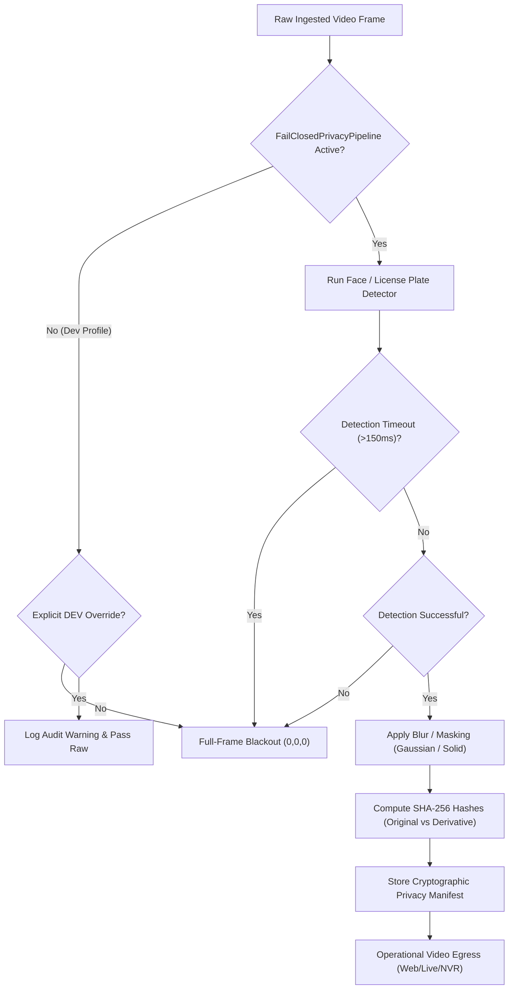

# CAMserv Privacy-First Architecture

**Document ID:** ARCH-PRIVACY-2026-001  
**Classification:** Civil Liberties & Compliance Specification  
**Version:** 1.0.0  
**Date:** November 15, 2026  

---

## 1. Regulatory Context and Architectural Invariants

CAMserv is engineered to satisfy the strictest international privacy frameworks, including the **European Union General Data Protection Regulation (GDPR)**, the **EU Artificial Intelligence Act (AI Act)**, and the **California Consumer Privacy Act (CCPA)**.

### Fundamental Privacy Invariants:
1. **Mandatory Fail-Closed Pipeline:** Privacy filtering is not an optional post-processing filter. It is an immutable gate in the video processing pipeline. If privacy processing fails or times out, the system defaults to total frame blackout.
2. **Prohibition of Biometric Surveillance:** Facial recognition, biometric feature vector extraction, and persistent cross-camera identity matching are strictly absent from the codebase.
3. **Immutability of Original Footage:** Privacy-masked operational video is strictly separated from pristine original forensic evidence. AI-processed or enhanced imagery never overwrites raw footage.
4. **Dual-Control Raw Evidence Export:** Exporting raw unmasked footage requires independent cryptographic authorization from two distinct authorized roles under GDPR Art. 25 (Privacy by Design).

---

## 2. Fail-Closed Privacy Pipeline Architecture

### Operational Mechanisms:
- **Centralized Enforcement:** Positioned as an immutable gate directly between frame ingestion and all consumer subsystems.
- **Dynamic Masking Options:**
  - *Solid Box / Silhouette Masking:* Completely replaces detected human bodies or faces with solid neutral pixels.
  - *Gaussian Pixelation / Blur:* Renders facial features and vehicle license plates unidentifiable.
  - *Static Privacy Zones:* Blackens user-defined polygon regions (e.g., public sidewalks, neighboring residential windows).
- **Privacy Manifest Verification:** Every processed frame generates a verifiable link pairing the original pristine SHA-256 hash with the derivative masked hash, ensuring auditability without exposing original pixels.

---

## 3. Data Minimization & Retention

- **Automated 48-Hour Purge:** Standard continuous operational surveillance video is automatically deleted after 48 hours under GDPR Art. 5.1(e).
- **WAN Data Minimization:** Transmission of raw surveillance video over wide-area networks is blocked by `camserv.central.comm`. Edge nodes exchange only structured metadata and cryptographic hashes.
- **Judicial Hold Locking:** Chunks tagged with judicial holds are preserved in an encrypted, WORM-protected forensic vault until formal legal resolution.
