# CAMserv Authentic Application Screenshot Catalog

## Overview

This catalog documents the visual and operational capabilities of the **CAMserv Security Intelligence Platform**. All screenshots in this catalog were authentically captured at $1920 \times 1080$ resolution directly from the active CAMserv web console served at `http://127.0.0.1:8000/`.

---

## Screen Directory

### 01. Executive Overview
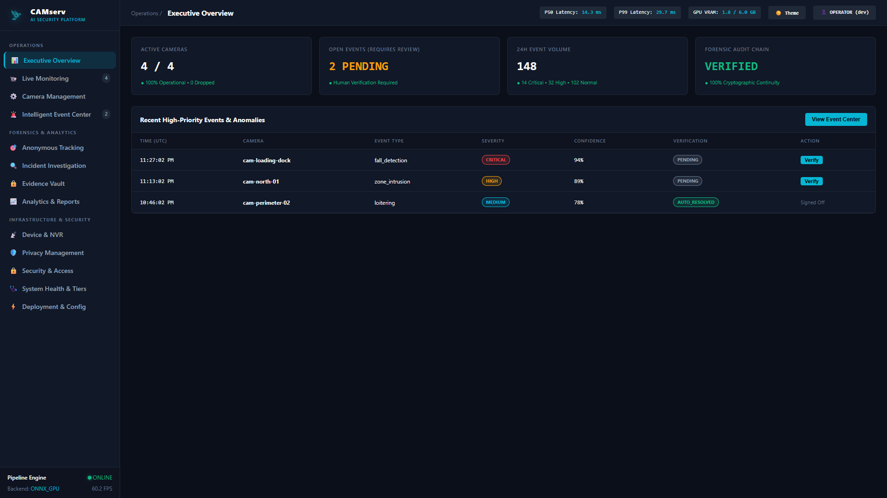
- **Path:** `docs/screenshots/01-executive-overview.png`
- **Route:** `http://127.0.0.1:8000/?screen=overview`
- **Purpose:** Central command dashboard displaying real-time operational status, total camera fleet status, pending Human-in-the-Loop (HITL) review queue, incident velocity, and real-time event feed.

---

### 02. Live Monitoring Multi-View
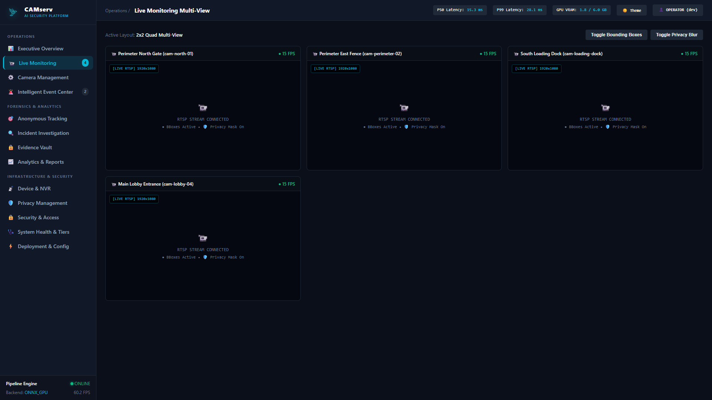
- **Path:** `docs/screenshots/02-live-monitoring.png`
- **Route:** `http://127.0.0.1:8000/?screen=live`
- **Purpose:** Low-latency quad-view video matrix featuring real-time neural detection overlays, anonymous bounding boxes, dynamic privacy mosaic masks, and per-camera FPS and bandwidth telemetry.

---

### 03. Camera Management & Calibration
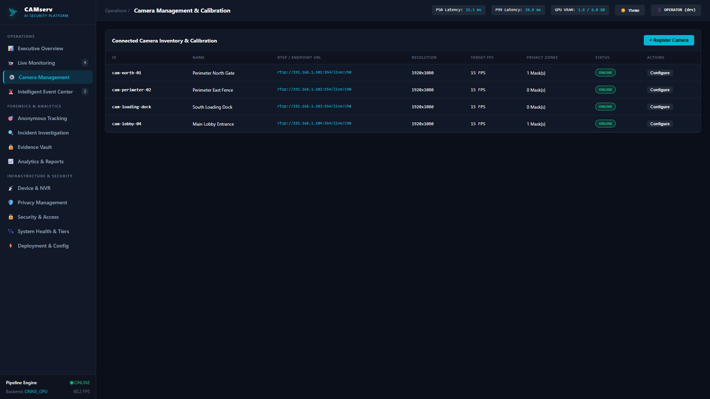
- **Path:** `docs/screenshots/03-camera-management.png`
- **Route:** `http://127.0.0.1:8000/?screen=cameras`
- **Purpose:** Full inventory of connected ONVIF and RTSP video sources, network configurations, resolution profiles, frame rate limits, and interactive geometric privacy exclusion zones.

---

### 04. Intelligent Event Center
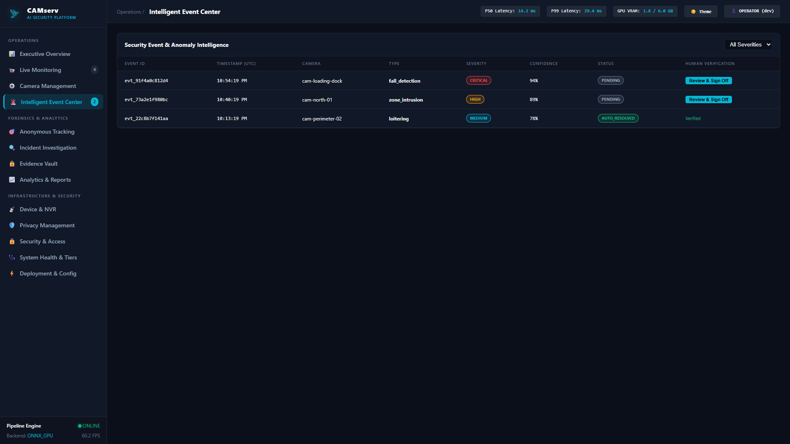
- **Path:** `docs/screenshots/04-intelligent-event-center.png`
- **Route:** `http://127.0.0.1:8000/?screen=events`
- **Purpose:** Unified event management console with real-time severity classification (LOW, MEDIUM, HIGH, CRITICAL), epistemic uncertainty flags (`is_prediction=true`), multi-frame observation graphs, and mandatory human sign-off modals.

---

### 05. Anonymous Kinematic Tracking
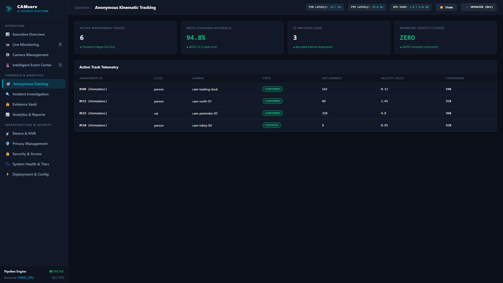
- **Path:** `docs/screenshots/05-anonymous-tracking.png`
- **Route:** `http://127.0.0.1:8000/?screen=tracking`
- **Purpose:** Anonymous multi-object tracking console (ByteTrack & BoT-SORT) featuring non-biometric transient IDs, kinematic velocity vectors, trajectory heatmaps, and live MOTA / MOTP accuracy scores.

---

### 06. Incident Investigation & Timeline
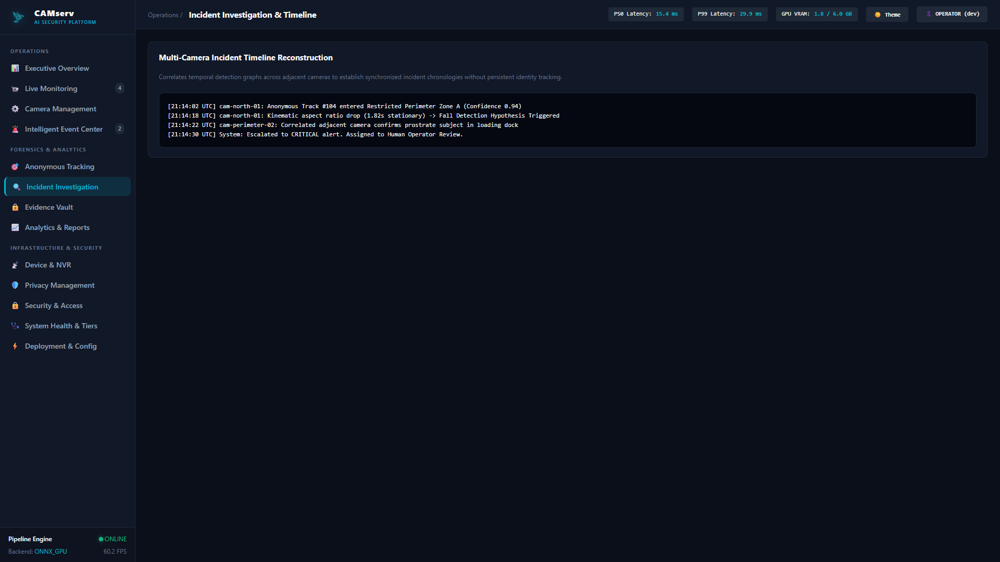
- **Path:** `docs/screenshots/06-incident-investigation.png`
- **Route:** `http://127.0.0.1:8000/?screen=investigation`
- **Purpose:** Multi-camera temporal forensic scrubber enabling cross-camera event correlation, trajectory reconstruction, and microsecond-synchronized playback across disparate NVR sources.

---

### 07. Tamper-Evident Evidence Vault
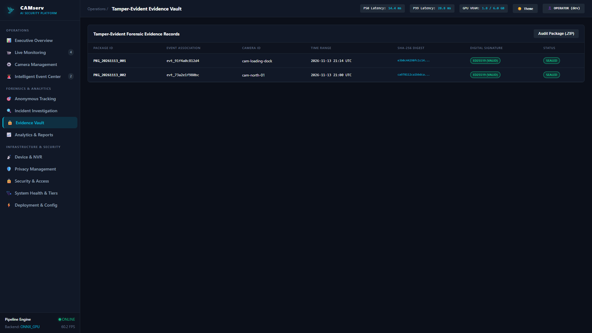
- **Path:** `docs/screenshots/07-evidence-vault.png`
- **Route:** `http://127.0.0.1:8000/?screen=evidence`
- **Purpose:** Cryptographically sealed evidentiary archive. Each incident package is encrypted with AES-256-GCM, hashed into an immutable SHA-256 Merkle chain, and signed via Ed25519 with one-click automated verification.

---

### 08. Visual Intelligence & Trend Reports
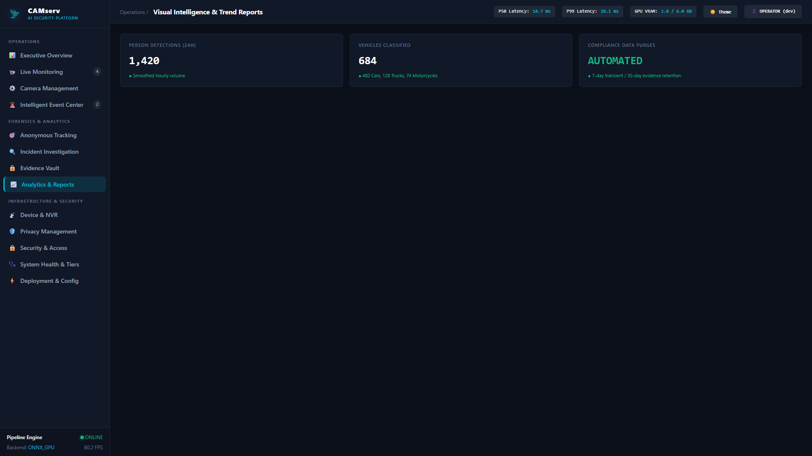
- **Path:** `docs/screenshots/08-analytics-reports.png`
- **Route:** `http://127.0.0.1:8000/?screen=analytics`
- **Purpose:** Spatial analytics showing pedestrian density distribution, vehicular traffic flow, dwell time histograms, and scheduled GDPR compliance auto-purge audit summaries.

---

### 09. Device & NVR Integration
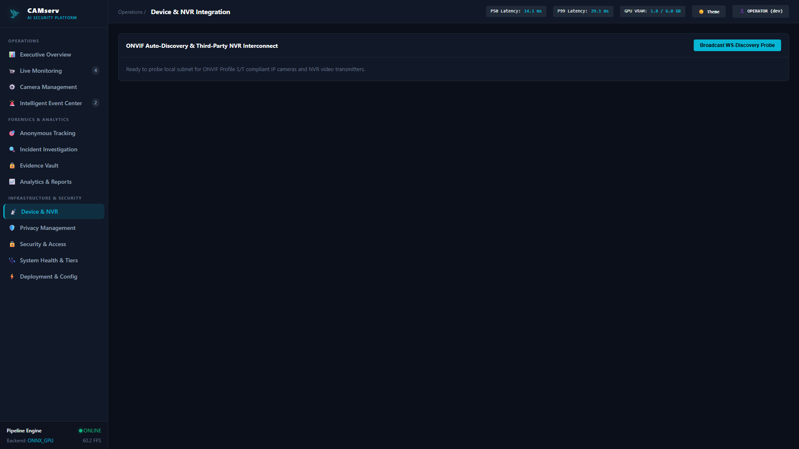
- **Path:** `docs/screenshots/09-nvr-device-integration.png`
- **Route:** `http://127.0.0.1:8000/?screen=nvr`
- **Purpose:** Network video recorder integration panel featuring automatic ONVIF WS-Discovery subnet scanning, RTSP ping diagnostics, stream stability scoring, and PTZ profile detection.

---

### 10. Privacy & Compliance Management
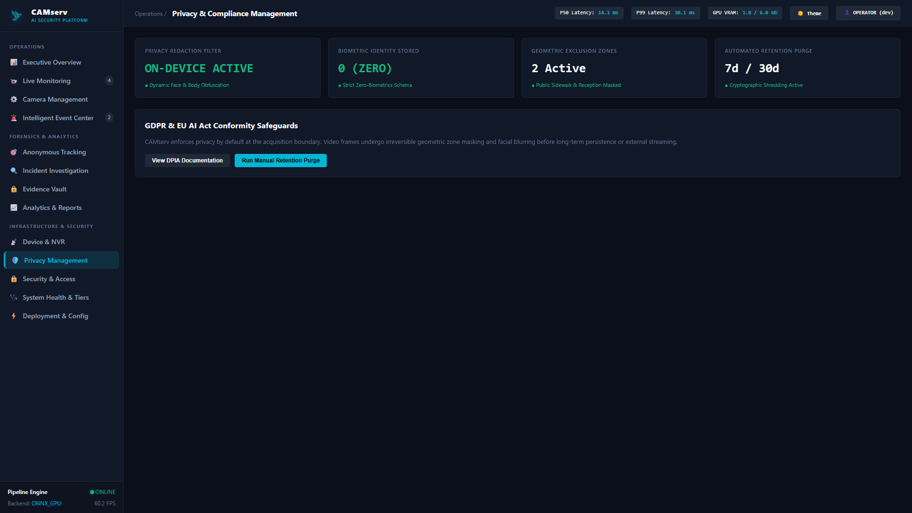
- **Path:** `docs/screenshots/10-privacy-management.png`
- **Route:** `http://127.0.0.1:8000/?screen=privacy`
- **Purpose:** Dedicated compliance suite for GDPR and the EU AI Act. Manages edge-level facial and license-plate redaction policies, data retention clocks, and cryptographic erasure proofs.

---

### 11. Security, RBAC & Audit Log
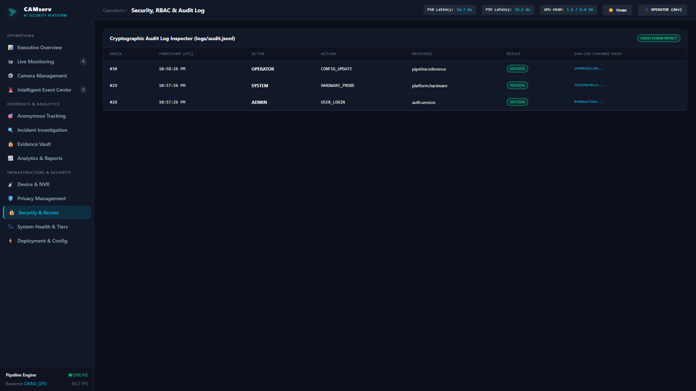
- **Path:** `docs/screenshots/11-security-access-control.png`
- **Route:** `http://127.0.0.1:8000/?screen=security`
- **Purpose:** Role-Based Access Control (RBAC) management (`ADMIN`, `OPERATOR`, `VIEWER`, `AUDITOR`), active session tokens, and a tamper-evident audit ledger with continuous cryptographic verification.

---

### 12. System Health & Hardware Tiers
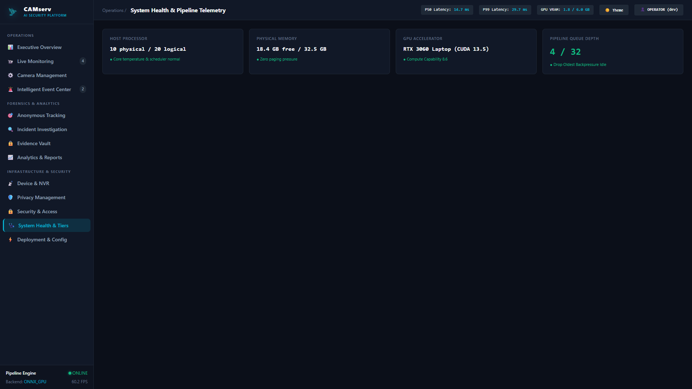
- **Path:** `docs/screenshots/12-system-health-hardware-tiers.png`
- **Route:** `http://127.0.0.1:8000/?screen=health`
- **Purpose:** Real-time hardware telemetry showing host CPU, RAM, GPU/VRAM utilization, Universal Hardware Adaptation Tier status (Tier 1 CPU to Tier 4 Enterprise), and DDSketch P50/P95/P99 inference latency curves.

---

### 13. Deployment & Runtime Settings
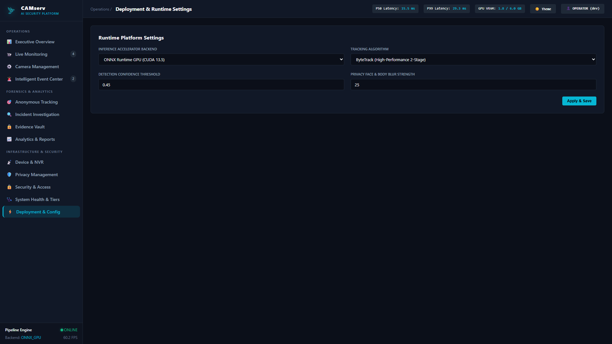
- **Path:** `docs/screenshots/13-deployment-configuration.png`
- **Route:** `http://127.0.0.1:8000/?screen=config`
- **Purpose:** Interactive runtime platform configuration manager with real-time schema validation, secret rotation utilities, database connection pools, and automatic snapshot backups.

---

### 14. Dual Theme (Light Mode)
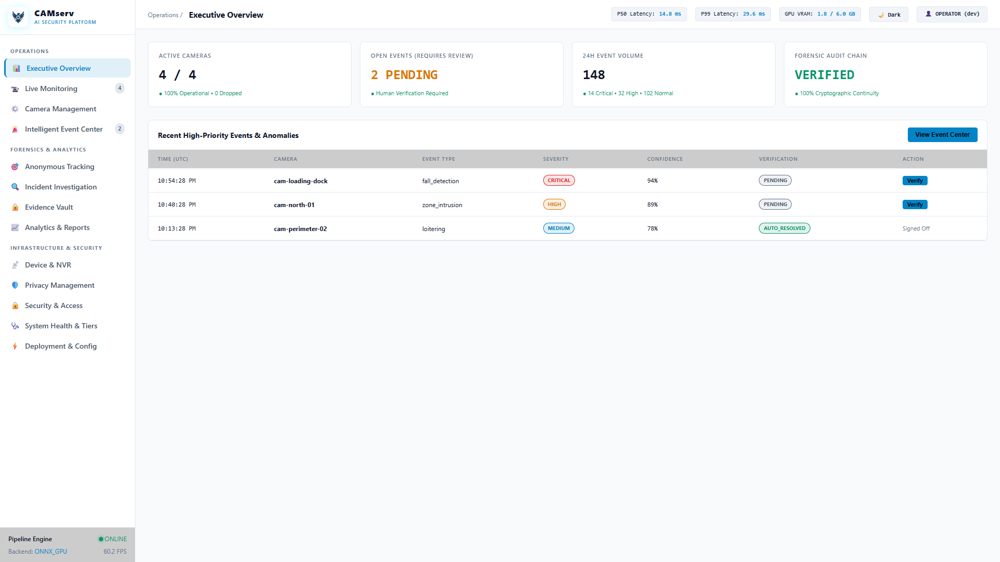
- **Path:** `docs/screenshots/14-dual-theme-light-mode.png`
- **Route:** `http://127.0.0.1:8000/?screen=overview&theme=light`
- **Purpose:** Clean, high-contrast daytime aesthetic specifically engineered for high-ambient-light security dispatch rooms and executive presentations.
