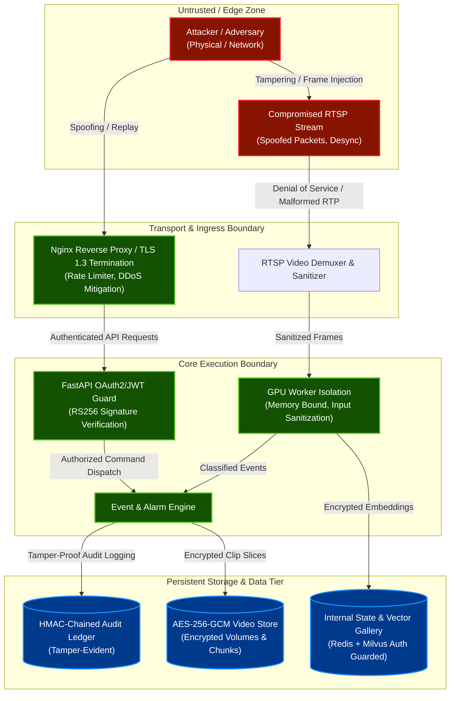
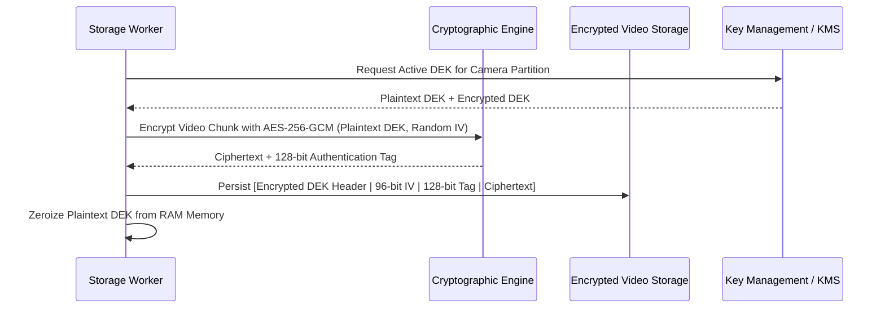
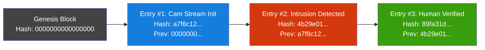
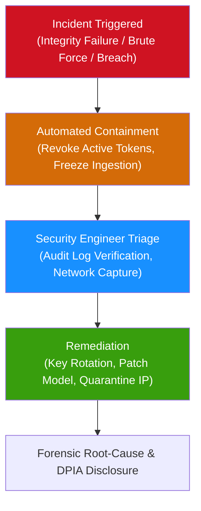

# CAMserv — Security Architecture & Threat Model

> **Document Version:** 1.0.0  
> **Status:** Production Security Baseline  
> **Target Environment:** Python 3.14 / FastAPI / Cryptography 41+ / PyJWT / Redis / Milvus / Linux & Windows Hardened Hosts

---

## 1. Security Architecture Overview & Principles

CAMserv handles sensitive surveillance feeds, spatial tracklets, and high-stakes perimeter intelligence. The security architecture enforces defense-in-depth across the ingestion network, edge inference hardware, internal message buses, persistence layers, and API clients.

### Core Security Tenets
1. **Zero-Trust Communication:** All internal and external network communication requires explicit mutual authentication and encryption. No boundary is trusted implicitly.
2. **Cryptographic Immutability:** Audit trails and video chunk records employ cryptographic hash chains and HMAC digests to detect tampering, modification, or truncation.
3. **Least Privilege & Role Segregation:** Access is scoped strictly through granular Role-Based Access Control (RBAC). System operators cannot alter audit trails, and auditors cannot modify camera configurations.
4. **Epistemic Accountability:** Machine learning outputs are protected against adversarial manipulation and never trigger external or physical actions without cryptographically signed human-in-the-loop (HITL) authorization.

---

## 2. STRIDE Threat Model

The following diagram maps key threat vectors and attack surfaces evaluated using the Microsoft STRIDE methodology.



### Detailed STRIDE Threat Mitigation Matrix

| Threat Category | Threat Scenario | Impact | Mitigation Strategy |
| :--- | :--- | :--- | :--- |
| **Spoofing** | Attacker impersonates an authorized security operator to dismiss critical intrusion alerts. | High (Physical Breach) | Asymmetric RS256 JWT tokens with short lifetimes (30m), strict signature verification, and mandatory hardware MFA on review endpoints. |
| **Spoofing** | Attacker injects a synthetic camera feed pretending to be an authorized RTSP stream. | High (Blind Spot) | RTSPS (TLS-wrapped RTSP) or dedicated isolated VLANs with static IP/MAC binding and stream authentication credentials. |
| **Tampering** | Rogue actor modifies recorded video clips or drops frames from disk to erase evidence of intrusion. | Critical (Legal Invalidation) | Video chunks split into 10-second segments; each segment is hashed with SHA-256 and chained into an immutable HMAC ledger. |
| **Repudiation** | Operator falsely claims an alarm was never presented or that an automated rule acted autonomously. | High (Accountability Failure) | Structured logging via `structlog` appended to a cryptographically chained HMAC-SHA256 log file; operator review actions require signed timestamps. |
| **Information Disclosure** | Unauthorized staff snooping on live surveillance video feeds. | Critical (GDPR Violation) | AES-256-GCM encryption for stored video; RBAC endpoint enforcement; live streams undergo real-time facial blurring by default. |
| **Denial of Service** | Volumetric flooding of API or malformed RTSP packet storm crashing inference workers. | High (System Outage) | Sliding-window token bucket rate limiting (300 req/min default), memory ring-buffer backpressure caps, and frame dimension clamp checks. |
| **Elevation of Privilege** | Read-only viewer attempts to alter privacy masking zones or delete recorded tracks. | High (Integrity Compromise) | Strict role check dependencies in FastAPI (`Depends(RequireRole("admin"))`); scopes verified against cryptographic token claims. |

---

## 3. Cryptography & Encryption Standards

### 3.1 Transport Encryption (Data in Transit)
- **Protocol:** TLS 1.3 mandatory; TLS 1.2 permitted only with secure cipher suites. SSLv3, TLS 1.0, and TLS 1.1 are explicitly disabled.
- **Cipher Suites:**
  - `TLS_AES_256_GCM_SHA384`
  - `TLS_CHACHA20_POLY1305_SHA256`
  - `TLS_AES_128_GCM_SHA256`
- **Internal Microsegmentation:** Communication between FastAPI, Redis, and Milvus utilizes TLS encapsulation. Redis requires `rediss://` with client authentication certificates in production.

### 3.2 Storage Encryption (Data at Rest)
- **Video Chunks & Snapshots:** All video files written to `data/video/` and detection crops in `data/snapshots/` are encrypted using AES-256-GCM.
- **Envelope Encryption Pattern:**
  - **Data Encryption Key (DEK):** Unique 256-bit symmetric key generated per 24-hour recording block or camera partition.
  - **Key Encryption Key (KEK):** Master key loaded from secure environment variables or external KMS (HashiCorp Vault / AWS KMS) used to wrap DEKs.
- **Initialization Vectors (IVs):** Cryptographically secure random 96-bit IV generated per chunk via `os.urandom(12)`. IV is stored prepended to the ciphertext. Never reused under the same key.



---

## 4. Authentication, Authorization & RBAC

### 4.1 Token Lifecycle & Asymmetric Signing
Authentication relies on RFC 7519 JSON Web Tokens (JWT) signed via **RS256** (RSA Signature with SHA-256) utilizing a 4096-bit private key.

- **Access Token TTL:** 30 minutes (stateless, validated locally by API gateways).
- **Refresh Token TTL:** 7 days (stateful, persisted in Redis with device binding and rotation on every issuance).
- **Revocation List:** Redis-backed Bloom filter and blacklist store invalid tokens (e.g. on operator logout or session termination).

```json
{
  "iss": "camserv",
  "sub": "usr_948a7f21b",
  "aud": "camserv-api",
  "role": "operator",
  "permissions": [
    "cameras:read",
    "detections:read",
    "events:read",
    "events:write",
    "alerts:read"
  ],
  "exp": 1731542400,
  "iat": 1731540600,
  "jti": "d6e32bb8-7a54-469b-8e12-88f57262a041"
}
```

### 4.2 Role-Based Access Control (RBAC) Matrix

| Permission String | Viewer | Operator | Auditor | Admin | Description |
| :--- | :---: | :---: | :---: | :---: | :--- |
| `cameras:read` | ✅ | ✅ | ✅ | ✅ | View camera streams, status, and health metrics. |
| `cameras:write` | ❌ | ✅ | ❌ | ✅ | Add, edit, or toggle camera RTSP ingestion streams. |
| `detections:read` | ✅ | ✅ | ✅ | ✅ | Inspect real-time bounding boxes and track paths. |
| `events:read` | ✅ | ✅ | ✅ | ✅ | Query incident reports and alarm logs. |
| `events:write` | ❌ | ✅ | ❌ | ✅ | Acknowledge alarms and execute HITL decisions. |
| `alerts:read` | ❌ | ✅ | ✅ | ✅ | View configured alert thresholds and geofences. |
| `alerts:write` | ❌ | ✅ | ❌ | ✅ | Create or adjust perimeter trigger policies. |
| `privacy:manage` | ❌ | ❌ | ❌ | ✅ | Define privacy masking zones and anonymization rules. |
| `audit:read` | ❌ | ❌ | ✅ | ✅ | Read cryptographic audit ledger and verify hashes. |
| `system:config` | ❌ | ❌ | ❌ | ✅ | Update GPU batch sizes, network ports, and secrets. |
| `system:purge` | ❌ | ❌ | ❌ | ✅ | Force-trigger GDPR right-to-erasure workflows. |

---

## 5. Tamper-Evident Audit Logging & Hash Chaining

Standard file-based logging is susceptible to post-incident truncation or log line modification. CAMserv implements a **tamper-evident audit chain** using HMAC-SHA256 linking.

### 5.1 Chained Ledger Schema
Each log entry includes:
$$\text{Entry Hash}_i = \text{HMAC-SHA256}(K_{\text{audit}}, \text{Sequence}_i \parallel \text{Timestamp}_i \parallel \text{Entry Hash}_{i-1} \parallel \text{Payload JSON})$$



### 5.2 Verification Utility
The platform provides a cryptographically verifiable auditor routine (`camserv.security.audit.verify_ledger`) that iterates sequentially through the audit ledger, recalculates HMAC digests against the secure key $K_{\text{audit}}$, and asserts chain integrity. Any deleted line, altered timestamp, or mutated payload raises an immediate integrity violation alarm.

---

## 6. Video Tamper Detection & Chain-of-Custody

For forensic evidentiary integrity, raw video is never stored as an unbounded single file. 

1. **Chunking:** Streams are segmented into fixed 10-second MP4/Fragmented MKV slices.
2. **Chunk Digest:** Upon completion of slice encoding, the worker calculates:
   $$H_{\text{chunk}} = \text{SHA-256}(\text{Chunk Bytes})$$
3. **Chain of Custody Record:** A metadata manifest is written alongside the video:
   ```json
   {
     "camera_id": "cam_north_gate",
     "chunk_id": "chunk_20261113_201500_001",
     "start_pts_ns": 1731539700000000000,
     "end_pts_ns": 1731539710000000000,
     "frame_count": 150,
     "sha256": "e3b0c44298fc1c149afbf4c8996fb92427ae41e4649b934ca495991b7852b855",
     "source_ip": "192.168.10.45",
     "ingest_node": "worker-gpu-01",
     "signature": "3045022100e4d9...[ECDSA-P256-Signature]"
   }
   ```
4. **Export Manifest:** When clips are extracted for review or legal transfer, the complete package includes the cryptographic manifest, camera serial telemetry, and the digital signature of the exporting operator.

---

## 7. Hardened Secrets Management & Infrastructure

1. **Strict Environment Ingestion:**
   No secrets, keys, or passwords may exist in source code, configuration YAMLs, or Docker image layers. All credentials pass via `CAMSERV_` environment variables or injected Docker secrets.
2. **Memory Scrubbing (Zeroization):**
   Sensitive key buffers (`SecretStr` in Pydantic) are zeroized in RAM upon disposal using `ctypes.memset` or native OpenSSL memory wiping routines.
3. **Vault Integration Architecture:**
   Production deployments utilize an init-container or sidecar pattern querying HashiCorp Vault via AppRole authentication. Dynamic database credentials for Redis and transient encryption keys are rotated automatically every 24 hours.

---

## 8. HTTP Security Headers & Web Armor

All outbound HTTP responses from the FastAPI gateway inject mandatory protective headers:

```http
Content-Security-Policy: default-src 'self'; script-src 'self'; style-src 'self' 'unsafe-inline'; img-src 'self' data: blob:; connect-src 'self' wss:; frame-ancestors 'none';
Strict-Transport-Security: max-age=63072000; includeSubDomains; preload
X-Frame-Options: DENY
X-Content-Type-Options: nosniff
X-XSS-Protection: 1; mode=block
Referrer-Policy: strict-origin-when-cross-origin
Permissions-Policy: geolocation=(), camera=(), microphone=()
```

---

## 9. Incident Response & Threat Containment Playbook



1. **Step 1: Automated Containment**
   - High-rate authentication failure triggers automated IP blacklisting at Nginx firewall via Fail2ban integration.
   - Audit hash discrepancy immediately triggers read-only lock across all administrative API routes.
2. **Step 2: Emergency Key Invalidation**
   - Execute token flush in Redis: `redis-cli -n 0 FLUSHDB` to terminate all existing active operator sessions.
   - Rotate JWT RS256 keypair and broadcast rotation notice.
3. **Step 3: Forensic Chain Export**
   - Extract the complete HMAC audit file, freeze disk snapshot volumes, and verify the exact block index of integrity divergence.
4. **Step 4: Statutory Reporting**
   - If personal data or unblurred surveillance video is exposed, generate breach notification report within 72 hours under GDPR Article 33.
