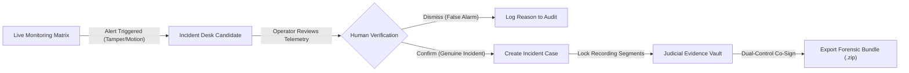

# CAMserv — User Experience Architecture & Navigation Workflows

**Document ID:** ARCH-UX-2026-001  
**Project:** CAMserv Advanced Security Intelligence Platform  
**Target Visual Direction:** Cinematic Dark / Multi-Layer Glassmorphism  
**Date:** November 17, 2026  
**Auditor:** Principal Enterprise UX Architect  

---

## 1. Information Architecture & Navigation Hierarchy

The CAMserv interface is organized into three operational domains accessible from the persistent left-hand command rail:

```
+---------------------------------------------------------------------------------------+
| TOP COMMAND BAR: Cluster Health | Lease Status | Tenant | Audit Invariant | Profile   |
+-------------------+-------------------------------------------------------------------+
| COMMAND RAIL      | MAIN OPERATIONAL VIEWPORT (Multi-Layer Glass Canvas)               |
|                   |                                                                   |
| [OPERATIONS]      |                                                                   |
| - Overview (📊)   |  +-------------------------------------------------------------+  |
| - Live Monitor(📹)|  | Active Screen Viewport                                      |  |
| - Cameras (⚙️)    |  | (Dashboard / Camera Matrix / Forensic Vault / Cluster Desk) |  |
| - Event Center(🚨)|  +-------------------------------------------------------------+  |
|                   |                                                                   |
| [FORENSICS]       |                                                                   |
| - Tracking (🎯)   |                                                                   |
| - Incident (🔍)   |                                                                   |
| - Evidence (🔒)   |                                                                   |
| - Analytics (📈)  |                                                                   |
|                   |                                                                   |
| [INFRASTRUCTURE]  |                                                                   |
| - Device/NVR (📡) |                                                                   |
| - Privacy (🛡️)    |                                                                   |
| - Security (🔒)   |                                                                   |
| - Health (🩺)     |                                                                   |
| - Config (⚡)      |                                                                   |
+-------------------+-------------------------------------------------------------------+
```

---

## 2. Core Operational Workflows

### 2.1 Surveillance Monitoring to Incident Investigation Workflow


1. **Detection Ingestion:** An automated AI detection occurs on a camera channel. The event displays probabilistic confidence tags (`confidence: 0.88`, `is_prediction: true`).
2. **Review & Verification:** The operator inspects the keyframe and surrounding video clips. The event remains a *candidate* until human review.
3. **Evidence Preservation:** Upon confirmation, the operator clicks "Lock Segments". The system creates an immutable forensic hold on the corresponding MP4 video segments.
4. **Courtroom Chain of Custody:** If judicial export is requested, the system prompts for Dual-Control Authorization. Two officers must authenticate with distinct credentials before unmasked raw video is decrypted.

### 2.2 Split-Brain & Storage Lease Recovery Workflow
When network partitions or node failures occur:
1. **Fencing Visual Notice:** If a cluster node loses majority quorum, the top banner turns deep crimson: `[PARTITIONED - STORAGE WRITES FENCED]`.
2. **Quarantine Isolation:** Any incomplete segment written by a stale writer is immediately moved to `*.quarantined.mp4`.
3. **Audit Verification:** The operator reviews the quarantine queue under the Forensics tab, verifying SHA-256 integrity before authorizing manual re-indexing or permanent discard.

---

## 3. Keyboard Navigation & Accessibility Ergonomics

To maximize operational speed during high-intensity incidents, CAMserv supports full keyboard navigation without requiring mouse interaction:

| Shortcut | Action | Operational Scope |
| :--- | :--- | :--- |
| `Ctrl + 1` | Switch to **Executive Overview** | Global |
| `Ctrl + 2` | Switch to **Live Monitoring Matrix** | Global |
| `Ctrl + 3` | Switch to **Camera Management** | Global |
| `Ctrl + 4` | Switch to **Intelligent Event Center** | Global |
| `Ctrl + 5` | Switch to **Anonymous Tracking** | Global |
| `Ctrl + 6` | Switch to **Incident Investigation** | Global |
| `Ctrl + 7` | Switch to **Evidence Vault** | Global |
| `Ctrl + 8` | Switch to **System Health & Hardware Tiers**| Global |
| `Ctrl + K` or `/` | Focus Global Telemetry & Camera Search | Global |
| `Space` | Pause / Resume Playback Scrubber | Live Monitoring & Timeline |
| `Esc` | Dismiss Active Modal / Cancel Operation | Modals & Dialogs |
| `Tab` / `Shift+Tab` | Accessible Focus Traversal across Inputs | Forms & Navigation |
