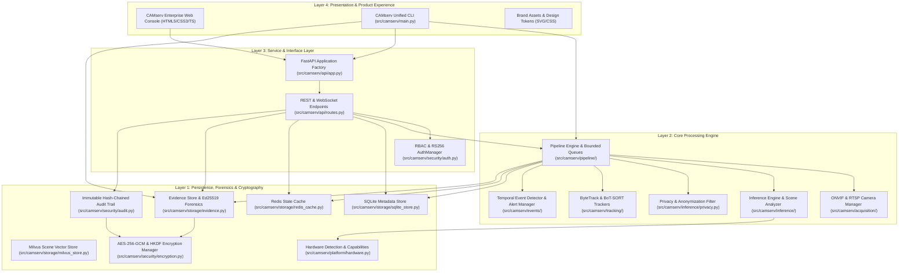

# CAMserv System Dependency Map

### Subsystem Inter-Dependencies:
1. **Acquisition Layer** depends on `OpenCV` / `aiohttp` / socket networking; falls back to synthetic video generators in headless/offline tests.
2. **Inference Layer** depends on `ONNXRuntime` / `CUDA` / `NumPy`; falls back to pure NumPy/CPU math when hardware acceleration is unavailable.
3. **Tracking Layer** depends on `SciPy` (Hungarian assignment) / `NumPy`; operates purely on numerical coordinates and anonymous integer IDs.
4. **Events Layer** depends on Tracking outputs and Privacy-filtered spatial zones; enforces human verification for consequential alerts.
5. **Storage Layer** provides hybrid persistence: SQLite for transactional configurations and state, Redis for low-latency active tracks, Milvus for non-identifying scene vectors, and encrypted disk for tamper-evident evidence packages.
6. **API & Web Console** depends on FastAPI, consuming the storage and pipeline layers while serving static assets and REST/WebSocket APIs.
