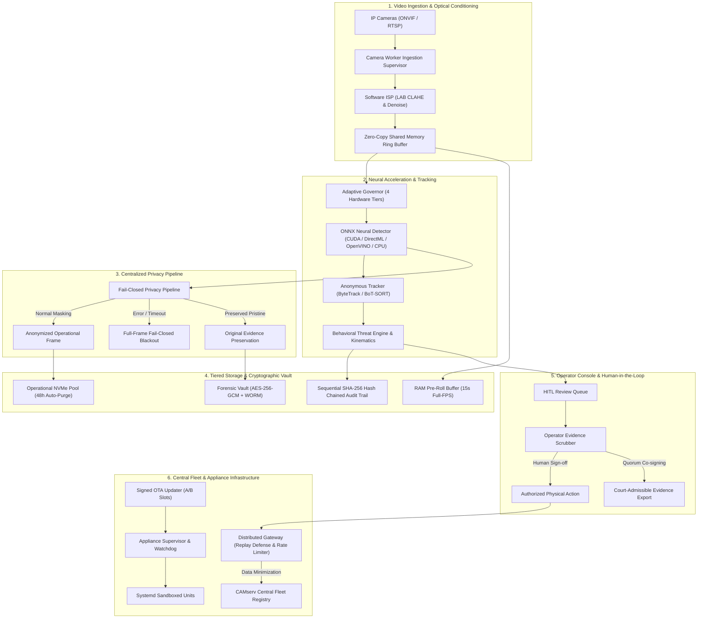

# CAMserv — Public Technical Architecture Overview

**Document ID:** ARCH-OVERVIEW-PUBLIC-2026-001  
**Project:** CAMserv Advanced Security Intelligence Platform  
**Target Repository:** `aboulouafaeit-sys/CAMserv.IT`  
**Date:** November 15, 2026  

---

## 1. High-Level Architectural Diagram

The diagram below reflects the verified production architecture across all 10 subsystems of CAMserv:

---

## 2. Subsystem Descriptions & Guarantees

### 2.1 Video Ingestion & Optical Conditioning
- **Worker Isolation:** Camera acquisition workers execute in isolated child processes communicating via shared memory rings. A camera disconnection, decoder hang, or network timeout never impacts adjacent camera streams.
- **Software ISP:** Computes stream quality metrics every 5 seconds. In low-light environments, real-time LAB-color CLAHE (Contrast Limited Adaptive Histogram Equalization) equalizes luminance without introducing chroma artifacts.

### 2.2 Neural Acceleration & Anonymous Tracking
- **Hardware Agnostic Execution:** Supports NVIDIA CUDA/TensorRT, Windows DirectML, Intel OpenVINO, and ONNX Runtime CPU with automatic fallback on driver fault.
- **Strict Camera-Scoped Tracking:** Multi-object trackers assign temporary integer track IDs scoped strictly to an individual camera feed. Persistent biometric profiling across feeds is prohibited.
- **Epistemic Modesty:** Algorithmic detections are explicitly marked as probabilistic hypotheses (`is_prediction: true`) with bounded confidence scores.

### 2.3 Fail-Closed Centralized Privacy Enforcement
- **Universal Privacy Invariant:** Operational streaming, previews, and recordings are routed through the centralized privacy enforcer.
- **Guaranteed Fail-Closed Blackout:** If the detector or masking filter fails or encounters an unhandled exception, the pipeline defaults to complete frame blackout, preventing unmasked video leakage.
- **Cryptographic Provenance:** Generates a `PrivacyEvidenceManifest` with SHA-256 hashes linking original evidence with masked derivatives.

### 2.4 Tiered Storage & Forensic Evidence Vault
- **Tier 1 (RAM Pre-Roll):** 15-second circular memory buffer continuously capturing full-framerate frames.
- **Tier 2 (Operational Storage):** Rolling storage automatically purged after 48 hours under GDPR storage minimization principles.
- **Tier 3 (Forensic Vault):** Incidents merge the 15-second pre-roll with event footage, encrypting chunks via AES-256-GCM and locking them under software WORM retention for 365 days.
- **Judicial Hold:** Prevents retention purging on records flagged for ongoing judicial inquiry.

### 2.5 Operator Governance & Human-in-the-Loop Review
- **Mandatory Human Verification:** High-severity events require an authorized operator to review synchronized evidence before any consequential action (strobe, siren, door lock) can be authorized.
- **Dual-Control Quorum:** Extracting unmasked raw video evidence strictly requires co-signing by both an authorized Forensic Investigator and a Tenant/Super Administrator.

### 2.6 Appliance OS, Central Gateway & Signed Updates
- **Systemd Sandboxing:** Minimal Linux service units with restricted capabilities and private temporary filesystems.
- **Distributed Gateway:** Ed25519-signed message envelopes with nonce replay protection and sliding-window rate limiting.
- **WAN Data Minimization:** Barred from transmitting raw video over WAN; metadata and cryptographic manifests only.
- **Signed OTA Updates:** Ed25519 release signature verification, Zip Slip containment, and atomic snapshot rollback on post-install health failure.
